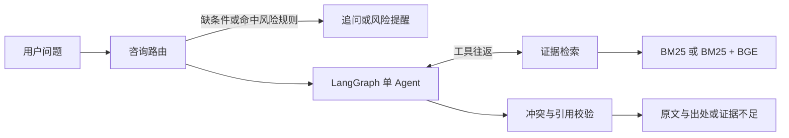

# 知衡医疗证据 Agent

一个本地运行的中文健康资料助手，用 LangGraph 调用检索工具，校验原文引用，并在条件缺失、证据冲突或工具失败时给出明确结果。

[](https://github.com/Dengzi555/zhiheng-medical-agent/actions/workflows/ci.yml)

## 快速开始

需要 Python 3.12。克隆后在项目目录执行：

```sh
python -m pip install -r requirements.txt
python demo.py
```

Demo 无需 API key、真实医疗资料或向量模型。它使用 [5 条合成资料](demo_corpus/) 和脚本模型，输出正常回答、追问、证据不足、证据冲突和工具失败共 5 个场景。

## 架构



证据条目保留原文、来源、页码或网页定位和快照指纹。程序验证引用身份、完整原文、版本关系和已标注的适用条件。没有结构化条件的资料会在轨迹中标记 `unstructured_scope`。

## 网页和真实资料

```sh
python server.py
```

打开 [本地网页](http://127.0.0.1:8765/)。网页提供对话历史、症状选项和引用侧栏。真实问答需要两项本地配置：

- 将 [.env.example](.env.example) 中需要的值载入进程环境。网页服务不会自动读取该文件。
- 按 [资料下载](docs/respiratory-materials-download.md) 和 [资料入库](docs/ingestion-and-consultations.md) 准备本地语料。外部资料快照、凭据、数据库和用户对话由本机保管。

`requirements-agent.txt` 包含可选 BGE 依赖。运行 `python hybrid_retrieval.py` 下载向量模型，用 `python hybrid_retrieval.py --check` 验证本机模型。资料向量缓存在忽略的 `data/bge-passage-cache/`，重启后可复用。向量模型不可用时回退到 BM25。MCP 接入见 [Craft 说明](integrations/craft/README.md)。

## 验收与评测

| 检查 | N 与口径 | 复现命令 | 版本 |
| --- | --- | --- | --- |
| 离线对话 | 5 个合成场景，按终止状态核对 | `python demo.py` | 当前 checkout |
| 自动化回归 | 测试发现计数由 runner 输出。缺可选资料或依赖时会标注跳过 | `python -m unittest -v` | 当前 checkout |
| 来源命中 | 使用本地语料，核对预期来源和小节的 Hit@1 / Hit@3，样本数见报告 | `python source_retrieval_eval.py` | 当前 checkout 和本地索引 |
| 开发问题 | 40 个合成问题，检查路由、追问和失败处理 | `python patient_acceptance.py` | 当前 checkout 和本地索引 |

记录复现实验时，用 `git rev-parse --short HEAD` 记录提交号。常见错误的轨迹和复现命令见 [失败案例](docs/failure-cases.md)。合成工程验收衡量流程行为，医学准确性需要独立评测。

## 范围

- 提供健康科普资料、出处、缺失条件追问和有限风险提醒。
- 不提供诊断、个体用药剂量或处方。冲突检查覆盖已结构化的主张。
- 适用性校验检查资料声明的范围。人工审核记录不是运行问答的前置条件。

变更见 [CHANGELOG](CHANGELOG.md)。项目源码使用 [MIT](LICENSE)。第三方项目沿用各自许可证。
