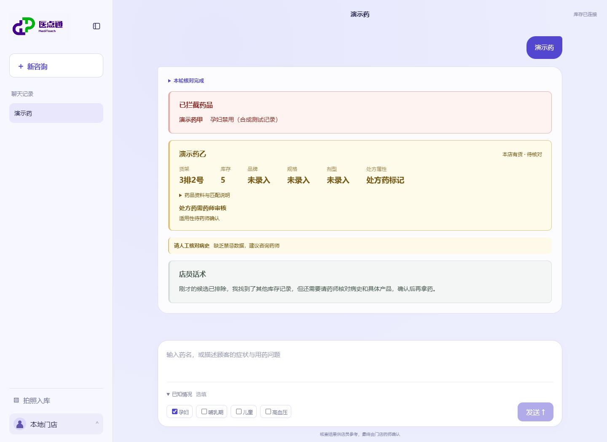
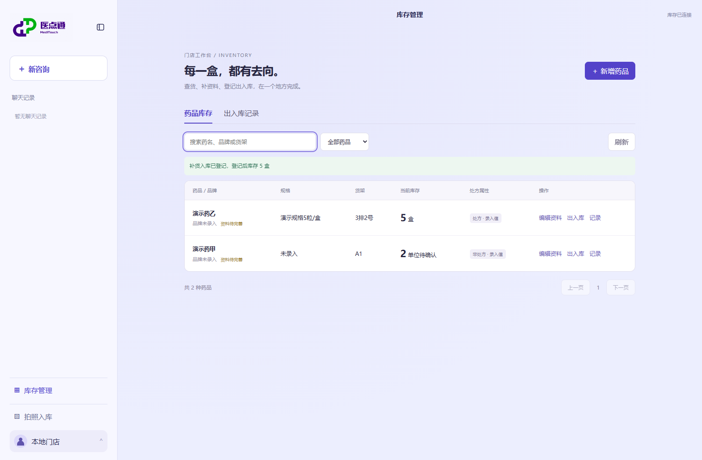
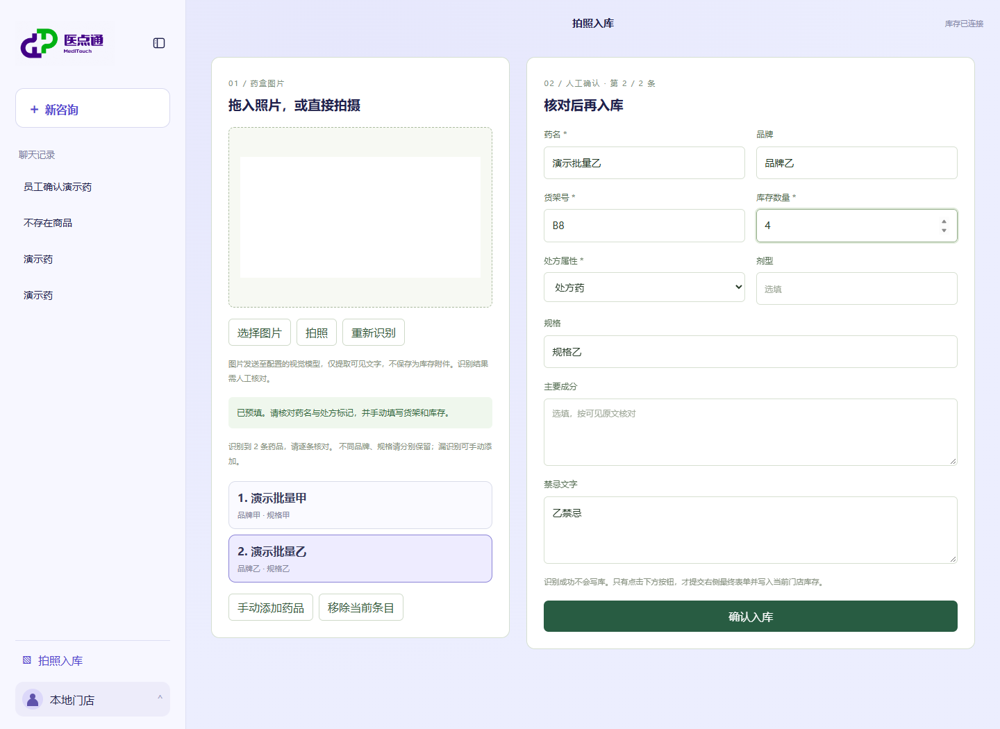
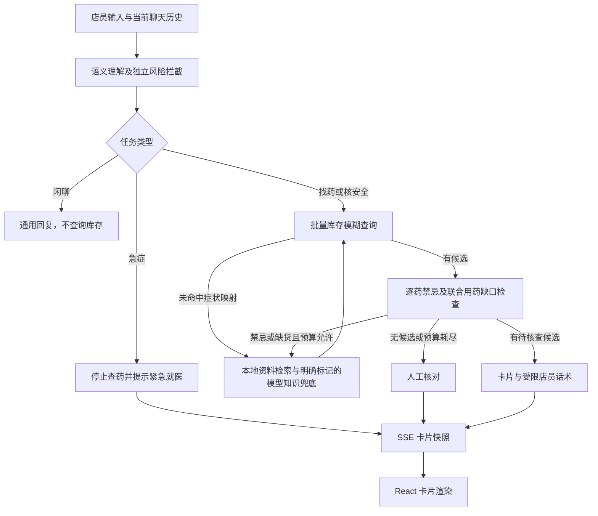

# 医点通 · MediTouch

面向实体药店店员与实习生的接待、找药和库存工作台。用自然语言查询本店商品、货架和库存，结合顾客信息筛查已录入的禁忌，再通过卡片呈现结果；支持多药盒拍照预填、人工确认入库，以及销售、补货、退货和盘点记账。

[](https://github.com/Dengzi555/meditouch-agent/actions/workflows/ci.yml)

## 核心能力

- **多轮理解**：模型识别找药、安全核查、急症与闲聊；结合当前聊天历史归一化症状，保留否认与未知。
- **会话保存**：聊天记录保存在本地 SQLite，刷新或重新打开会话可继续查询；不同会话分别保存接待上下文。
- **批量找药**：多药名、品牌一次 SQL 模糊查询，返回实际商品、货架、库存与处方标记；模糊结果明确要求核对具体产品。
- **知识补全**：症状映射未支持、禁忌拦截或缺货时，检索本地医学资料生成待核查药名；模型知识兜底单独标记来源，不伪装成检索证据。
- **强制核查**：每批库存候选必须核安全。排除药品及缺货记录跨轮保留，最多三轮库存、两轮知识补查；联合用药不依据单药检查直接放行。
- **未知不放行**：禁忌缺失、重名、未命中或工具失败均不视为安全；处方标记默认值也不构成非处方确认。
- **卡片回答**：红色拦截、黄色人工核对、库存候选和灰色店员话术。绿色仅保留给未来明确通过核验且有货的候选。
- **真实 SSE**：FastAPI 遍历 LangGraph 节点更新，React Hook 逐帧解析并替换卡片快照。新问题、停止或断线均不会残留旧推荐。
- **受限话术**：模型只在合规话术中选择；库存事实、风险分支和处方警示由宿主程序渲染。
- **多药盒识别**：一张图最多提取 12 种药品，分条保留品牌、规格及可见说明；员工逐条核对、补填货架与库存，确认后才写入。[配置与接口](docs/pharmacy-image-import.md)。
- **库存管理**：统一搜索和维护入库商品，登记销售、补货、退货与盘点；库存与变动记录同事务更新，防止重复扣减及超卖。[操作与接口](docs/inventory-management.md)。

## 界面

下图使用**隔离的合成库存和脚本模型**验证真实 FastAPI → LangGraph → SSE → React 链路，不代表真实药品资料或医学验证。默认服务不自动导入演示商品。



<details><summary>库存管理与多药盒入库</summary>




</details>

## 执行流程



## 本地启动

可点击左下角“本地门店”→“API 配置”，统一设置文本模型、视觉识别及可选公开知识接口。密钥不回显，点击保存后写入项目根目录 `.env`，下一次请求生效，重启后自动加载。配置入口仅限本机访问；`.env` 已被 Git 忽略。[配置说明](docs/api-settings.md)。

需要 Python 3.12+、Node.js 24。依赖：FastAPI、LangGraph、SQLModel、SQLite、React、TypeScript、Vite。

```powershell
python -m venv .venv-agent
.\.venv-agent\Scripts\python.exe -m pip install -r requirements.txt
npm --prefix web ci
npm --prefix web run build
```

先使用独立的演示库存启动。以下四条商品是合成夹具，不是真实说明书或经过医学审核的数据：

```powershell
.\.venv-agent\Scripts\python.exe seed_data.py
$env:MED_AGENT_INVENTORY_DB = (Join-Path (Get-Location) 'data/pharmacy_inventory_mock.db')
$env:MED_AGENT_INVENTORY_STORE_ID = 'local-store'
$env:MED_AGENT_API_KEY = '<模型密钥>'
$env:MED_AGENT_BASE_URL = '<兼容 Chat Completions 的地址>'
$env:MED_AGENT_MODEL = '<模型名称>'
.\.venv-agent\Scripts\python.exe server.py
```

打开 [本地页面](http://127.0.0.1:8765/)。未配置库存时页面明确提示，不返回演示库存。模型不可用时不猜测药名，查询按原文尝试，话术回退为固定内容。

接入本店商品时，按 [库存模型与录入说明](docs/pharmacy-copilot.md) 创建独立数据库，再使用入库页面录入。页面标出演示模式；空禁忌仍判为未知。已有药品缺少计数单位时，先在库存管理中确认单位，再登记出入库。

前端开发：`npm --prefix web run dev`；Vite 在 5173 端口代理 `/api` 到后端 8765。

## API 与代码

`POST /api/agent/stream`（别名 `/api/pharmacy/copilot/stream`）：

```json
{
  "question": "查找布洛芬缓释胶囊",
  "workspace": {
    "store_id": "local-store",
    "task": "drug_lookup",
    "customer": { "customer_tags": ["孕妇"] }
  }
}
```

返回 `text/event-stream`：`progress` → `cards.snapshot` → `done`，异常为 `error`。done 表示执行结束，不代表允许售药。原 NDJSON 实现已删除。

| 模块 | 位置 |
| --- | --- |
| FastAPI 路由与静态页面 | `meditouch/api.py` |
| 库存表与只读工具 | `meditouch/inventory_models.py`、`inventory_tools.py` |
| 图节点与条件路由 | `meditouch/pharmacy_graph.py` |
| 独立药店 State | `meditouch/pharmacy_state.py` |
| 共用风险检查与停止响应 | `meditouch/risk.py` |
| System Prompt 与受限生成 | `meditouch/pharmacy_generation.py` |
| JSON 卡片与 SSE 协议 | `meditouch/pharmacy_ui.py` |
| React Hook 与流解析 | `web/src/useCopilotStream.ts`、`sse.ts` |
| 卡片组件 | `web/src/CopilotCards.tsx` |
| 事务库存与出入库记录 | `meditouch/inventory_management.py`、`web/src/InventoryManager.tsx` |

完整说明：[药店流程](docs/pharmacy-copilot.md) · [UI 协议](docs/pharmacy-ui-protocol.md)。

## 验证

```powershell
.\.venv-agent\Scripts\python.exe -m unittest discover -s tests -t .
npm --prefix web test
npm --prefix web run build
```

测试覆盖库存默认值与约束、禁忌未知、排除重查、循环上限、真实 ASGI SSE、非法参数、风险中断、UTF-8 分片和卡片解析。浏览器核对使用独立合成库存，不混入真实资料评测。

当前药店工作流的 [30 条合成场景评测](docs/evaluation/pharmacy-agentic-rag-30.md) 覆盖找药、风险拦截、联合用药、缺货与急症。该报告是固定版本的工程基线，包含失败案例，不代表临床效果；旧健康资料检索指标不能直接代表当前药店流程。

## 当前边界

目前是单店 demo：门店标识与数据库在宿主绑定，尚无员工权限、批号效期、收银对接、订单库存预占、结算或自动售药审批。禁忌工具仅做已录入文本的标签筛查，不能替代完整说明书、配伍核查或药师判断，也不会返回“安全通过”。

生成节点目前选择预设店员话术，不开放自由医学建议。检索药名是待核查线索，不能把“本店有货”解释成适合当前顾客。

原健康咨询与证据检索模块保留在代码中，默认页面已切换为药店工作流；旧账号、会话及患者页面未迁入此版 React 入口。

代码采用 MIT License。药品资料、外部内容及品牌素材的权利归各自权利人。
