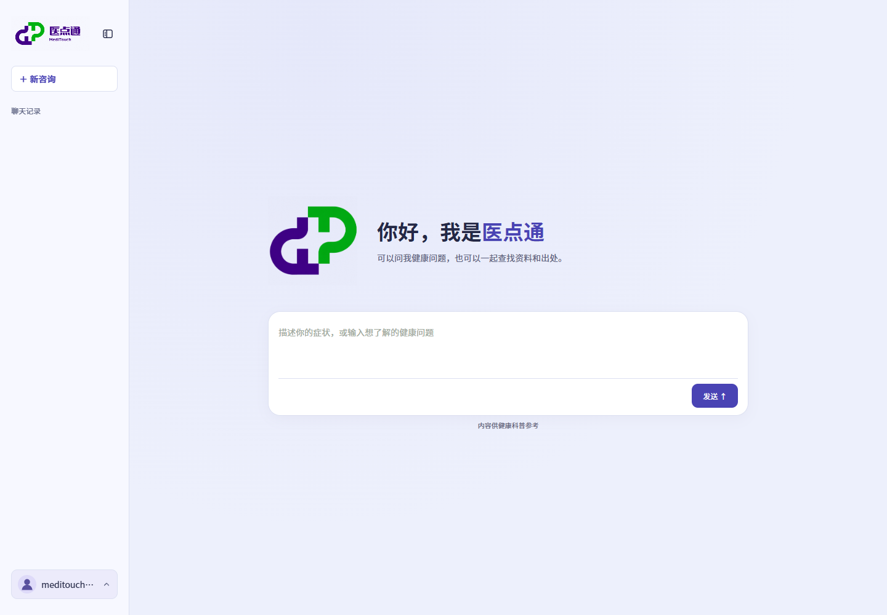
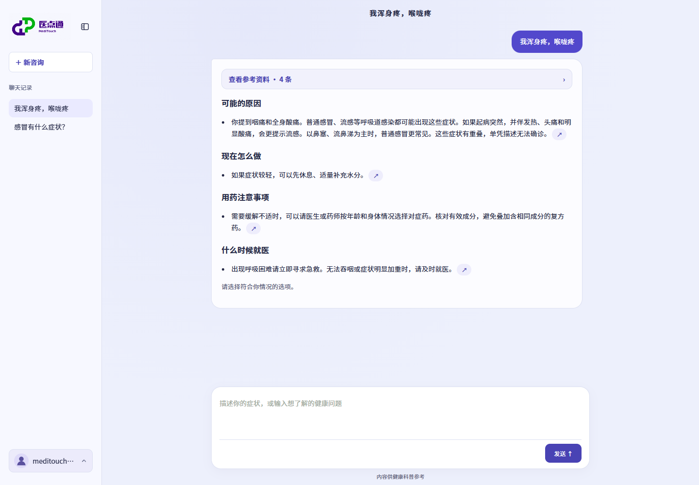
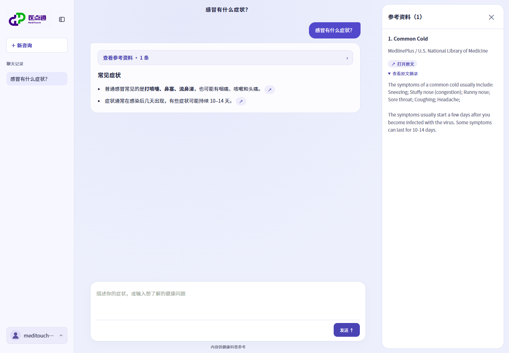
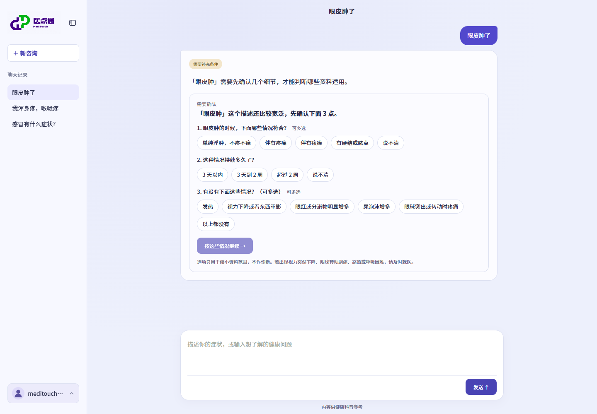
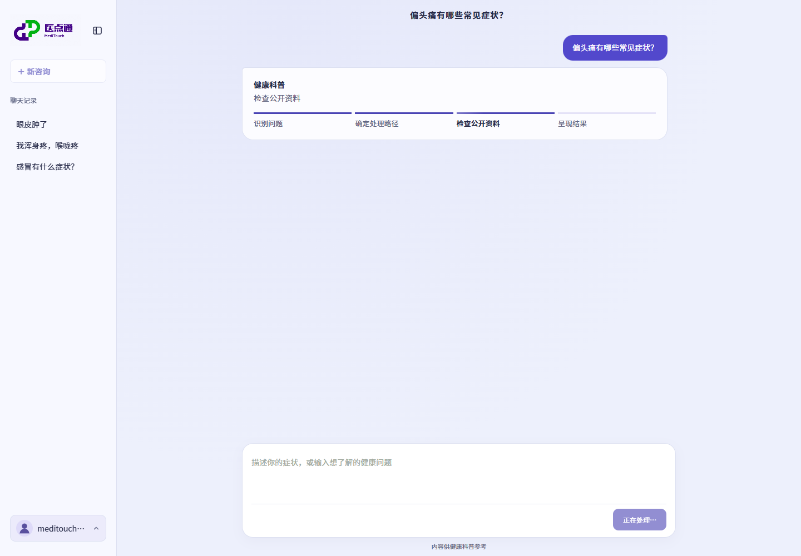
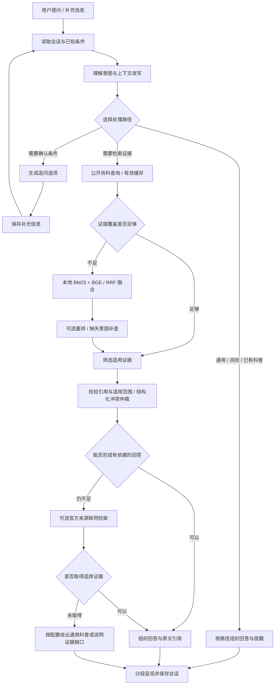

# 医点通 · MediTouch

面向日常健康咨询的医疗证据 Agent。理解口语与多轮追问，查询公开医学资料和本地知识库，将回答关联到可核对的原文与出处。

[](https://github.com/Dengzi555/meditouch-agent/actions/workflows/ci.yml)
[](https://www.python.org/)
[](LICENSE)



## 能力

- **连续咨询** — 保留原问、已知症状、否定信息和未知条件。结合历史改写省略式追问，补充信息后重新选择适用资料。
- **按需追问** — 对支持的宽泛症状展示选择卡片，根据新增信息缩小资料范围。风险选项优先触发就医提醒。
- **多源检索** — 公开资料优先，本地 BM25 + BGE 混合检索补充缺口。外部资料支持短期缓存，联网搜索和通用医学知识回退可选开启。
- **证据校验** — 核对引用身份、原文、快照指纹及已标注的适用条件。显式版本关系参与仲裁，未解决的结构化冲突保留双方。
- **流式呈现** — 展示实际处理阶段，分段逐步呈现回答。引用侧栏可展开原文、跳转来源。
- **会话管理** — SQLite 保存账号和咨询记录，支持对话重命名、置顶、删除及多选管理。通用聊天单独分流。

## 界面

以下为本地配置模型与资料后的真实页面截图，回答内容随资料、配置与用户输入变化。

### 症状咨询

回答按可能原因、当前处理、用药注意事项和就医情况组织，保留可核对的出处入口。



### 原文核对

参考资料侧栏展示来源、原文链接及引用摘录。



### 追问卡片

支持的症状通过选项收集有区分价值的条件。补充后继续当前咨询，更新检索范围和可支持的回答。



### 实时处理状态

界面展示当前执行阶段，包括问题识别、路径选择、公开资料查询和结果呈现。



## 处理流程



检索分支由 LangGraph 单 Agent 完成模型与工具往返。宿主限制执行时间、模型及工具调用预算，验证模型选择的证据后再输出。前端进度对应服务端阶段事件，回答经处理后通过事件流逐段传输。

## 快速开始

需要 Python 3.12 或更高版本。CI 使用 Python 3.12，在 Ubuntu 和 Windows 运行。

```sh
git clone https://github.com/Dengzi555/meditouch-agent.git
cd meditouch-agent
python -m venv .venv
```

激活虚拟环境。Windows PowerShell 使用 `..venvScriptsActivate.ps1`，macOS / Linux 使用 `source .venv/bin/activate`。

```sh
python -m pip install -r requirements.txt
python demo.py
```

`demo.py` 无需密钥，使用合成证据和 ScriptedModel 验证正常回答、需要追问、证据不足、证据冲突与工具失败五类终止结果。

### 启动网页

配置兼容 Chat Completions、支持工具调用和结构化输出的模型。以 PowerShell 为例，在同一终端设置环境变量并启动服务。

```powershell
$env:MED_AGENT_API_KEY = "你的模型密钥"
$env:MED_AGENT_BASE_URL = "https://api.openai.com/v1"
$env:MED_AGENT_MODEL = "gpt-4.1-mini"
python server.py
```

访问 **http://127.0.0.1:8765/**。模型与提供商可替换，具体可用性取决于接口兼容性。完整变量见 [.env.example](.env.example)，服务不会自动加载 `.env` 文件。

### 资料与模型配置

| 配置 | 默认 / 作用 |
| --- | --- |
| `MED_AGENT_PUBLIC_KNOWLEDGE` | `1`，公开资料优先，覆盖不足时补查本地资料 |
| `MED_AGENT_NHS_API_KEY` | 可选，启用 NHS Website Content API 适配器 |
| `MED_AGENT_SHOWAPI_APP_KEY` | 可选，启用万维易源适配器。接口权限依提供商方案而定 |
| `MED_AGENT_DEEPSEEK_SEARCH_KEY` | 可选，启用官方来源联网检索回退 |
| `MED_AGENT_RERANK` | `0`，设为 `1` 开启本地 Cross-Encoder 重排 |
| `MED_AGENT_GENERAL_HEALTH_FALLBACK` | `0`，设为 `1` 允许低风险科普在无证据时使用带明确标记的模型知识 |
| `PORT` | `8765`，网页服务端口 |

公开资料入口包括 MedlinePlus / NLM，NHS 和万维易源通过可选适配器接入。资料覆盖、网络可达性和接口权限影响实际返回。成功查询的公开证据缓存到 SQLite，有效期 12 小时。

安装本地向量检索依赖并准备模型。

```sh
python -m pip install -r requirements-agent.txt
python hybrid_retrieval.py
python hybrid_retrieval.py --check
```

BGE 使用 `BAAI/bge-small-zh-v1.5`，段落向量缓存于 `data/bge-passage-cache/`。模型不可用时回退到 BM25。可选重排模型为 `BAAI/bge-reranker-base`，通过 `python reranking.py` 准备。

真实资料快照和派生索引由使用者本地准备，不随仓库分发。运行 `python symptom_reference_pack.py --download` 可下载并切分 NHS 主题资料用于检索评测。该包标记为 `retrieval_only`，不会自动进入咨询回答池。其他资料的构建逻辑见 `reference_ingestion.py`、`common_reference_pack.py` 和 `rag_pipeline.py`，各入口需对应来源清单与原件。

## 检索评测

使用相同索引、查询预处理和 Top-5 对比三种方案。以下为真实公开资料的 **40 题新增段落级验证子集**，每题有目标小节。延迟为本机离线检索耗时。

| 方案 | Hit@1 | Hit@5 | MRR@5 | P95 |
| --- | ---: | ---: | ---: | ---: |
| BM25 | 35.0% | 57.5% | 0.428 | 8.5 ms |
| BM25 + BGE | 35.0% | 75.0% | 0.483 | 11.5 ms |
| 混合 + 重排 | 62.5% | 75.0% | 0.688 | 1,079.7 ms |

混合检索提高候选召回。重排改善前列排序，同时增加约 1.07 秒 P95，因此作为可选能力，默认关闭。

真实资料集共 84 题，包含 24 道开发题和 60 道验证题。验证部分由上述 40 道新题与 20 道历史题组成，历史题使用来源组级标签，报告单独列出。另保留 200 题合成检索夹具，用于检索管线回归。数据、完整指标及标注限制见 [评测报告](docs/eval-report.md)。

```sh
python symptom_reference_pack.py --download
python eval_retrieval_ab.py --mode source
python eval_retrieval_symptom_200.py
```

评测题由资料反向编写，检索命中率衡量目标证据的可检索性。它与医学回答准确性、真实用户满意度及端到端响应时间分别度量。复现时记录提交号、语料快照与本机模型版本。

## 开发与集成

```sh
python -m unittest
python demo.py
```

测试覆盖工具往返、证据适用性、引用校验、会话修订与并发、公开资料缓存和追问流程。缺少可选依赖或本地资料时，对应用例标记跳过。GitHub Actions 执行 Ruff 核心错误检查、单元测试与五类场景验证。

| 目录 / 模块 | 职责 |
| --- | --- |
| `agent_graph.py` / `model_gateway.py` | Agent 循环、模型接口与调用预算 |
| `consultation.py` / `query_plan.py` | 会话状态、多轮改写与查询计划 |
| `symptom_clarification.py` / `knowledge/` | 症状追问与条件收集 |
| `evidence_service.py` | 统一证据接口、仲裁与回答校验 |
| `hybrid_retrieval.py` / `reranking.py` | 混合检索、向量缓存与可选重排 |
| `public_health*.py` / `web_evidence.py` | 公开资料、缓存及联网回退 |
| `server.py` / `accounts.py` / `web/` | HTTP 服务、账号与网页 |
| `eval_data/` / `eval_corpus/` | 评测问题与合成夹具 |

HTTP 入口为 `POST /api/agent`、`POST /api/agent/stream` 和 `GET /api/session/{id}`。会话通过 `session_id` 和 `revision` 延续，过期修订返回 `409`。MCP 接入见 [集成说明](integrations/craft/README.md)。

## 使用边界与许可

医点通提供健康科普与资料核对，涉及诊断、个体剂量和处方的请求受范围限制。症状追问目前由注册表覆盖的主题驱动，证据收缩受资料与条件标注约束。英文来源可能保留英文摘录，外部数据服务也可能不可用。

账号、会话、缓存及本地配置存储于 `data/`。密钥通过环境变量提供，原始资料、运行数据库和凭据已配置为 Git 忽略项。对外部署应配置 HTTPS、访问控制、数据保留策略及适用场景的独立评估。

源码采用 [MIT License](LICENSE)。外部医学资料遵循各来源许可，公开访问不等于可自由再分发。NHS 内容许可见 [Open Government Licence v3.0](https://www.nationalarchives.gov.uk/doc/open-government-licence/version/3/)。版本记录见 [CHANGELOG](CHANGELOG.md)。
