# 医点通 · MediTouch

面向实体药店店员与实习生的接待、健康问答和库存工作台。结合当前会话理解顾客需求，解释健康问题，查询本店商品、货架与库存，并筛查已录入的禁忌。药盒拍照预填、确认入库、出入库登记和药品删除在同一网页完成。

库存事实由数据库提供，风险分支由程序控制，模型负责语义理解与资料解释。危险情况停止找药，切换到应急提示和现场交接记录。

[](https://github.com/Dengzi555/meditouch-agent/actions/workflows/ci.yml)

## 核心能力

- **多轮理解**：模型识别健康问答、找药、安全核查、急症与闲聊；用历史补全“那本店有什么药”等省略问句，归一化症状，保留否认与未知，不把助手举例当作顾客病史。
- **健康问答**：常见疾病、症状处理与药品一般知识先解释问题；按需查询公开接口与本地资料，核对引用，无适用资料时显式标注模型知识回答。[知识链路](docs/pharmacy-health-qa.md)。
- **会话保存**：聊天记录保存在本地 SQLite，刷新或重新打开会话可继续查询；不同会话分别保存接待上下文。
- **批量找药**：多药名、品牌一次 SQL 模糊查询，返回实际商品、货架、库存与处方标记；模糊结果明确要求核对具体产品。
- **知识补全**：症状映射未支持、禁忌拦截或缺货时，检索本地医学资料生成待核查药名；模型知识兜底单独标记来源，不伪装成检索证据。
- **强制核查**：每批库存候选必须核安全。排除药品及缺货记录跨轮保留，最多三轮库存、两轮知识补查；联合用药不依据单药检查直接放行。
- **未知不放行**：禁忌缺失、重名、未命中或工具失败均不视为安全；处方标记默认值也不构成非处方确认。
- **卡片回答**：结构化健康解释、重点加粗、来源折叠、点选追问、风险拦截与库存商品卡片。显示本店有货不代表适用或允许售药。
- **正文流式输出**：模型请求开启 stream；普通回复随文本增量更新，健康解释每段校验后即通过 LangGraph 自定义事件推送，无需等待整篇结束。React 逐帧更新卡片，新问题、停止或断线均不会残留旧推荐。
- **受限话术**：模型只在合规话术中选择；库存事实、风险分支和处方警示由宿主程序渲染。
- **节点级恢复**：SQLite Checkpointer 保存每轮图状态，中断后可继续同一请求；恢复库存任务时废弃旧库存与禁忌结论，重新查询和核查，不重复新增聊天消息。[实现与边界](docs/checkpoint-recovery.md)。
- **应急处置与交接**：危险分支停止查药，立即显示呼救与意识、呼吸相关处置提示；店员可补记现场观察、时间及已采取措施，生成可复制、可恢复的交接记录。[流程与来源](docs/emergency-support.md)。
- **多药盒识别**：一张图最多提取 12 种药品，分条保留品牌、规格及可见说明；员工逐条核对、补填货架与库存，确认后才写入。[配置与接口](docs/pharmacy-image-import.md)。
- **重复入库提示**：同药名、品牌已有记录时显示提示，可直接编辑已有商品；明确确认后仍可新建另一条记录，重复提交不会重复入库。
- **库存管理**：统一搜索和维护商品，登记销售、补货、退货与盘点；库存与流水同事务更新，版本校验避免重复扣减和超卖。删除前二次确认，删除后不再被找药工具返回，历史流水保留。[操作与接口](docs/inventory-management.md)。

## 界面

以下截图由当前网页重新采集，使用**隔离的合成库存、脚本模型与模拟视觉识别**，实际经过 FastAPI → LangGraph → SSE → React。健康问答示例使用带来源的 NHS 离线节选与固定输出；截图用于展示交互，不代表实时模型表现、真实商品资料或医学效果。默认服务不自动导入演示商品。

**本店商品查询**


**健康问答、引用与点选追问**

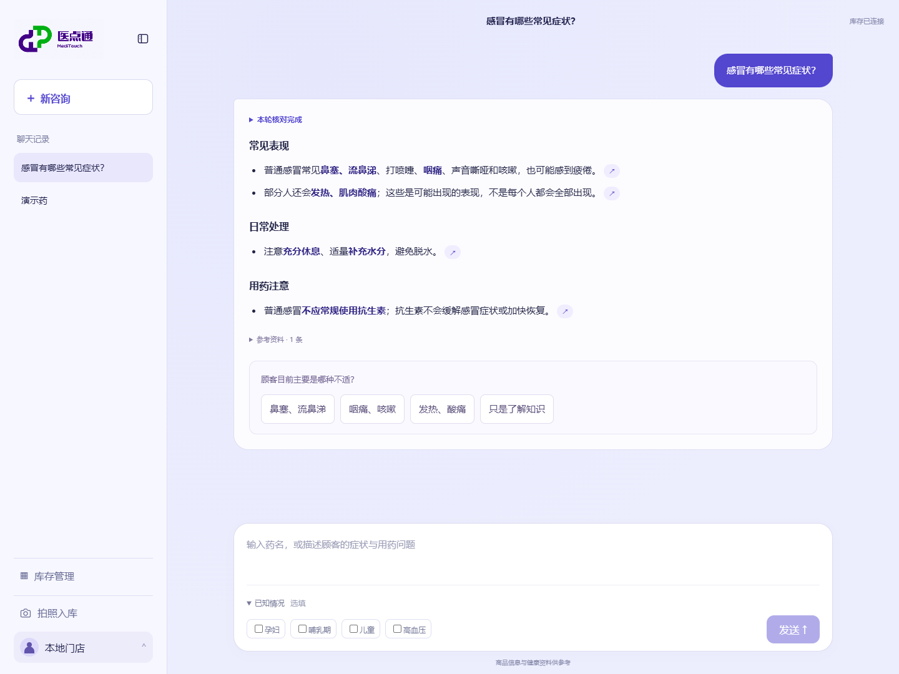

**库存管理与删除确认**

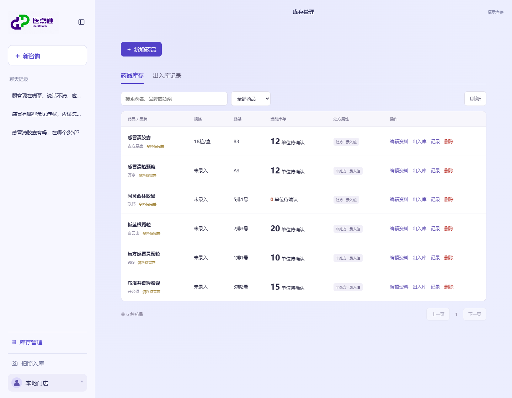
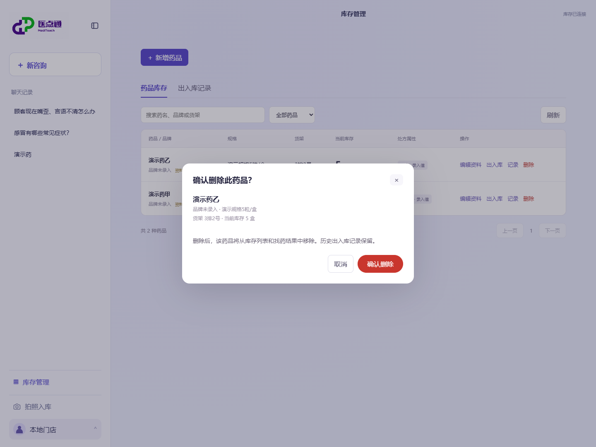

<details><summary>拍照入库、重复提示与库存流水</summary>

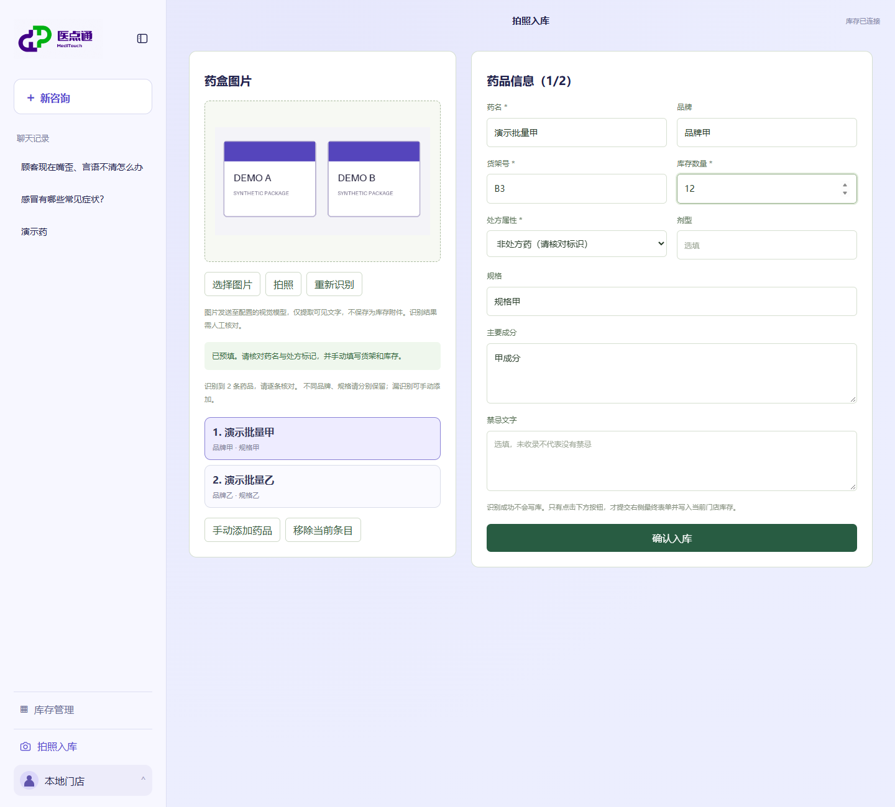
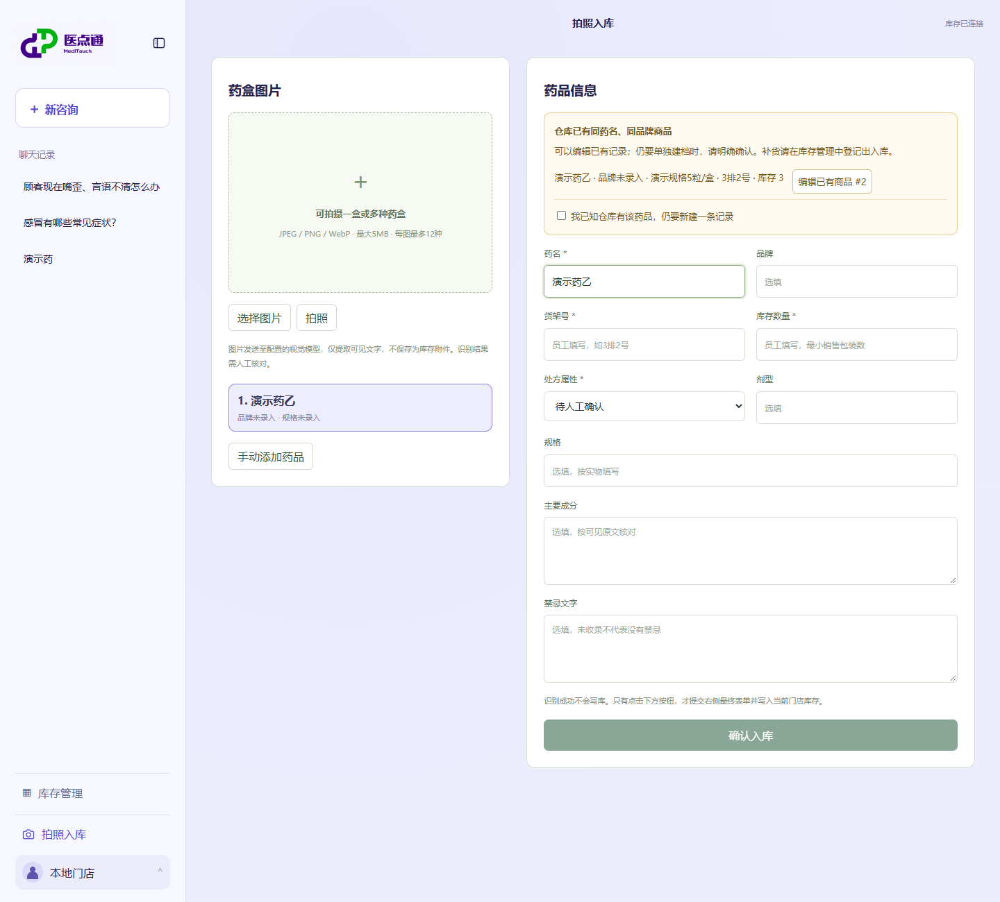
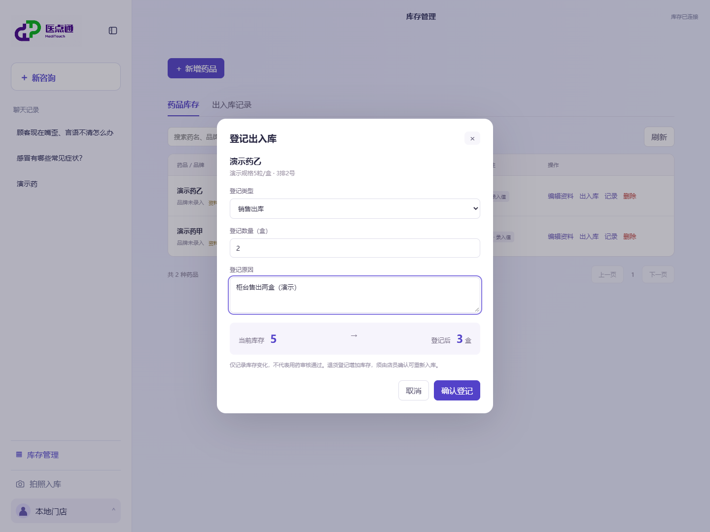
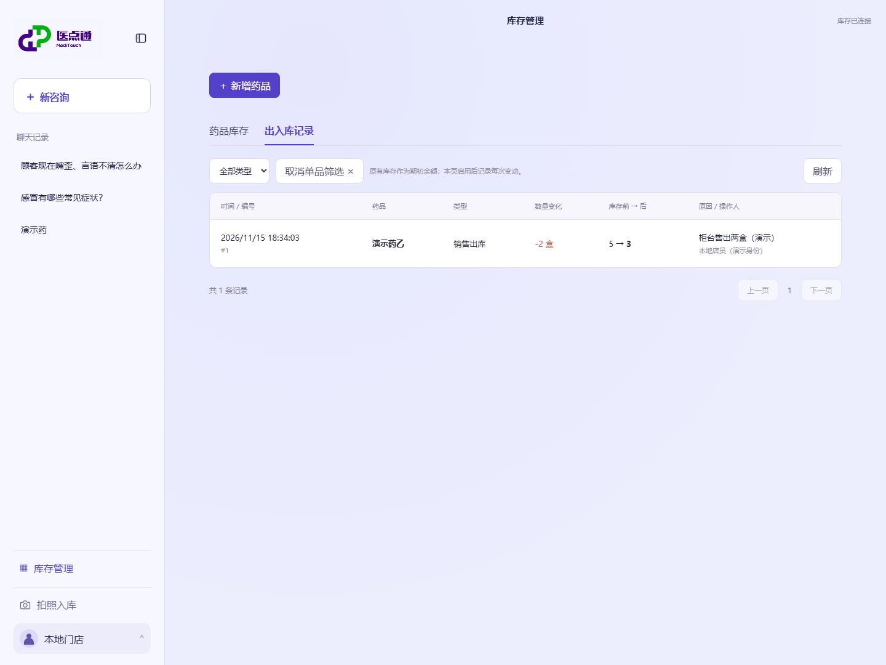

</details>

<details><summary>应急处置与现场交接</summary>

急救提示立即完整显示，不播放逐字动画。记录可以随后补充，不作为查看指引的前置条件。

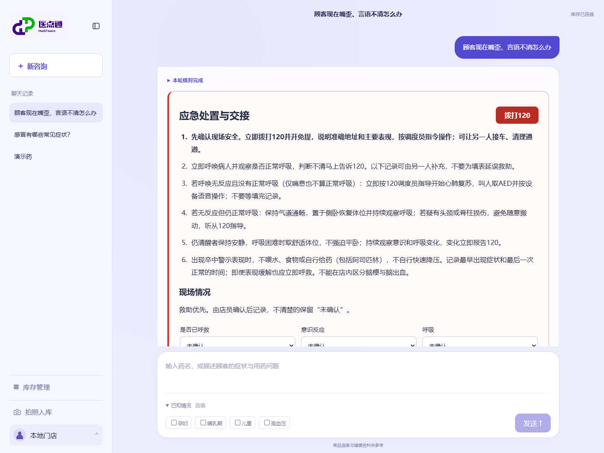
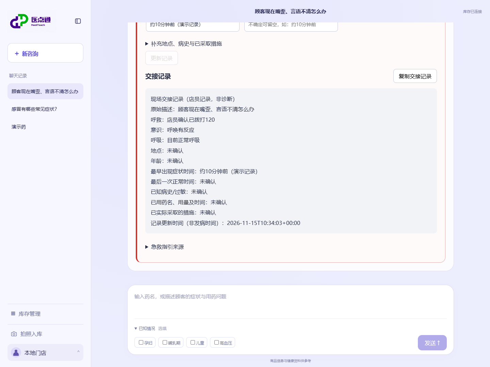

</details>

<details><summary>首页与模型设置</summary>

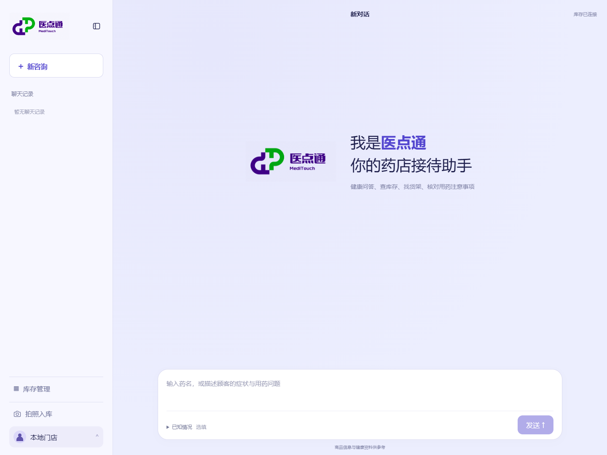
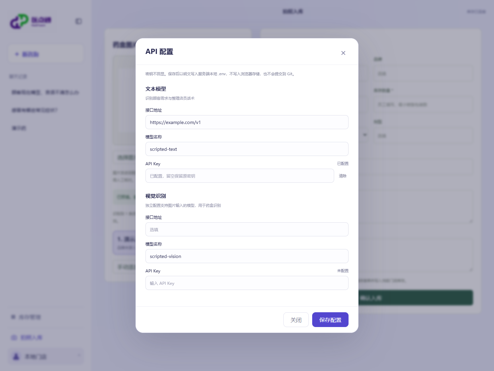

</details>

## 执行流程

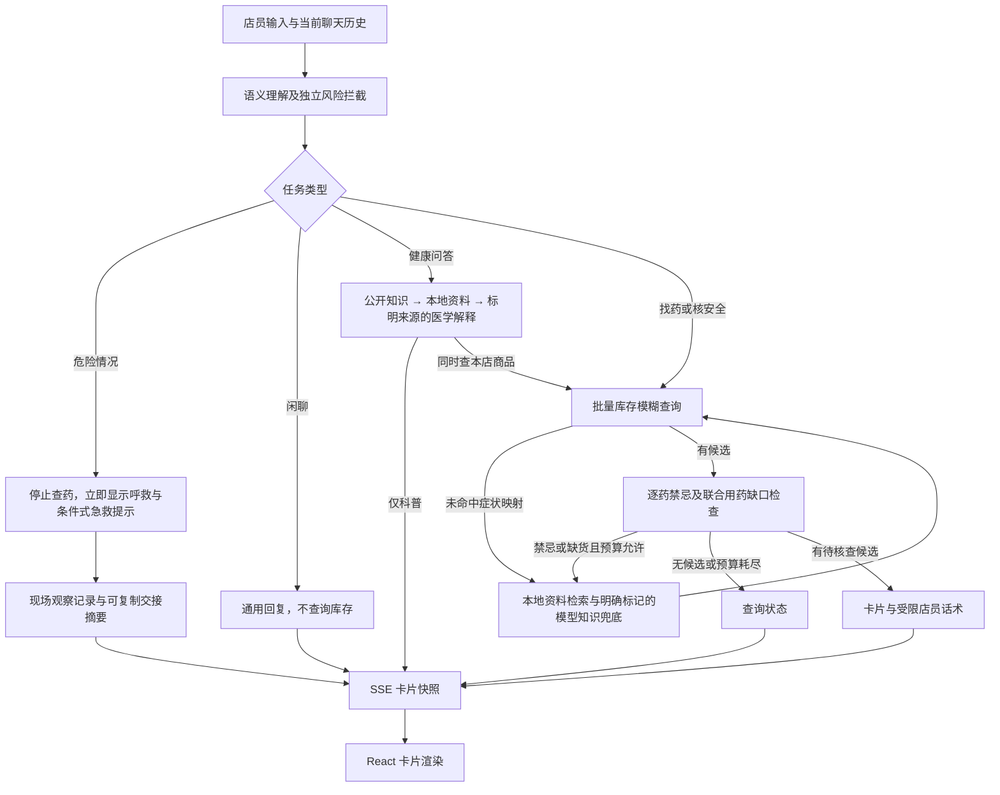

库存候选必须经过安全节点。禁忌命中后记录排除原因，再在预算内寻找其他候选；无证据、无库存或核查不完整时保留真实缺口，不伪造安全结论。执行中断后通过 SQLite Checkpointer 恢复节点状态；库存任务恢复时重新查库存与禁忌，不复用中断前的结论。

## 本地启动

可点击左下角“本地门店”→“API 配置”，设置文本模型与独立视觉模型。密钥不回显，保存到项目根目录 `.env`，下一次请求生效。公开知识和搜索配置由部署者在服务端维护，不要求店员填写。配置入口仅限本机访问；`.env` 已被 Git 忽略。[配置说明](docs/api-settings.md)。

需要 Python 3.12+、Node.js 24。依赖：FastAPI、LangGraph、SQLModel、SQLite、React、TypeScript、Vite。

```powershell
python -m venv .venv-agent
.\.venv-agent\Scripts\python.exe -m pip install -r requirements.txt
npm --prefix web ci
npm --prefix web run build
```

先使用独立的演示库存启动。以下四条商品是合成夹具，不是真实说明书或经过医学审核的数据：

```powershell
.\.venv-agent\Scripts\python.exe seed_data.py
$env:MED_AGENT_INVENTORY_DB = (Join-Path (Get-Location) 'data/pharmacy_inventory_mock.db')
$env:MED_AGENT_INVENTORY_STORE_ID = 'local-store'
$env:MED_AGENT_API_KEY = '<模型密钥>'
$env:MED_AGENT_BASE_URL = '<兼容 Chat Completions 的地址>'
$env:MED_AGENT_MODEL = '<模型名称>'
.\.venv-agent\Scripts\python.exe server.py
```

打开 [本地页面](http://127.0.0.1:8765/)。未配置库存时页面明确提示，不返回演示库存。模型不可用时不猜测药名，查询按原文尝试，话术回退为固定内容。

Windows 已完成配置后可执行 `powershell -NoProfile -ExecutionPolicy Bypass -File scripts/start_local.ps1`。启动器会检查服务、加载本地配置并打开网页；已有库存不会重新初始化。演示环境的默认库选择顺序见 `scripts/start_local_service.ps1`，本店业务库应明确配置 `MED_AGENT_INVENTORY_DB` 与 `MED_AGENT_INVENTORY_STORE_ID`，避免连接错库。

接入本店商品时，按 [库存模型与录入说明](docs/pharmacy-copilot.md) 创建独立数据库，再使用入库页面录入。页面标出演示模式；空禁忌仍判为未知。已有药品缺少计数单位时，先在库存管理中确认单位，再登记出入库。

前端开发：`npm --prefix web run dev`；Vite 在 5173 端口代理 `/api` 到后端 8765。

## API 与代码

`POST /api/agent/stream`（别名 `/api/pharmacy/copilot/stream`）：

```json
{
  "question": "查找布洛芬缓释胶囊",
  "workspace": {
    "store_id": "local-store",
    "task": "drug_lookup",
    "customer": { "customer_tags": ["孕妇"] }
  }
}
```

返回 `text/event-stream`：`progress` → `cards.snapshot` → `done`，异常为 `error`。done 表示执行结束，不代表允许售药。原 NDJSON 实现已删除。

| 模块 | 位置 |
| --- | --- |
| FastAPI 路由与静态页面 | `meditouch/api.py` |
| 库存表与只读工具 | `meditouch/inventory_models.py`、`inventory_tools.py` |
| 图节点与条件路由 | `meditouch/pharmacy_graph.py` |
| 会话、检查点与恢复 | `meditouch/chat_storage.py`、`checkpoints.py` |
| 健康知识与引用校验 | `meditouch/health_knowledge.py`、`pharmacy_health.py` |
| 应急指引与交接记录 | `meditouch/emergency_support.py`、`web/src/EmergencySupport.tsx` |
| 独立药店 State | `meditouch/pharmacy_state.py` |
| 共用风险检查与停止响应 | `meditouch/risk.py` |
| System Prompt 与受限生成 | `meditouch/pharmacy_generation.py` |
| JSON 卡片与 SSE 协议 | `meditouch/pharmacy_ui.py` |
| React Hook 与流解析 | `web/src/useCopilotStream.ts`、`sse.ts` |
| 卡片组件 | `web/src/CopilotCards.tsx` |
| 事务库存与出入库记录 | `meditouch/inventory_management.py`、`web/src/InventoryManager.tsx` |

完整说明：[药店流程](docs/pharmacy-copilot.md) · [UI 协议](docs/pharmacy-ui-protocol.md)。

## 验证

```powershell
.\.venv-agent\Scripts\python.exe -m unittest discover -s tests -t .
npm --prefix web test
npm --prefix web run build
```

测试覆盖库存默认值与约束、禁忌未知、排除重查、循环上限、真实 ASGI SSE、非法参数、风险中断、UTF-8 分片和卡片解析。浏览器核对使用独立合成库存，不混入真实资料评测。

本次本地验证：后端361项测试中357项通过、4项跳过；前端17项通过。新增覆盖删除确认与历史保留、并发销售/删除、节点恢复后的库存变化、应急记录保存以及增量输出。测试数量仅描述当前代码回归，不代表医学正确率。

截图复现：安装可选 `playwright` 后，在两个终端分别运行 `python -m scripts.documentation_ui_fixture` 和 `python -m scripts.capture_documentation_ui`。仅使用8767端口临时库存，不访问8765实际门店库，不调用付费模型；浏览器默认使用本机 Edge。

当前药店工作流的 [30 条合成场景评测](docs/evaluation/pharmacy-agentic-rag-30.md) 覆盖找药、风险拦截、联合用药、缺货与急症。该报告是固定版本的工程基线，包含失败案例，不代表临床效果；旧健康资料检索指标不能直接代表当前药店流程。

检索层单独使用 [100 题真实公开资料评测](docs/eval-report.md) 和 200 题合成夹具回归。真实题集覆盖 20 个主题、100 个不同小节，按精确段落 ID 比较 BM25、混合检索和重排；不与药店路由或医疗正确率混算。

## 当前边界

目前是单店 demo：门店标识与数据库在宿主绑定，尚无员工权限、批号效期、收银对接、订单库存预占、结算或自动售药审批。禁忌工具仅做已录入文本的标签筛查，不能替代完整说明书、配伍核查或药师判断，也不会返回“安全通过”。

库存接待话术仍使用受限选择；健康解释按资料生成结构化正文并核对引用，不提供个体化处方剂量。检索药名是待核查线索，不能把“本店有货”解释成适合当前顾客。

原健康咨询与证据检索模块保留在代码中，默认页面已切换为药店工作流；旧账号、会话及患者页面未迁入此版 React 入口。

代码采用 MIT License。药品资料、外部内容及品牌素材的权利归各自权利人。
