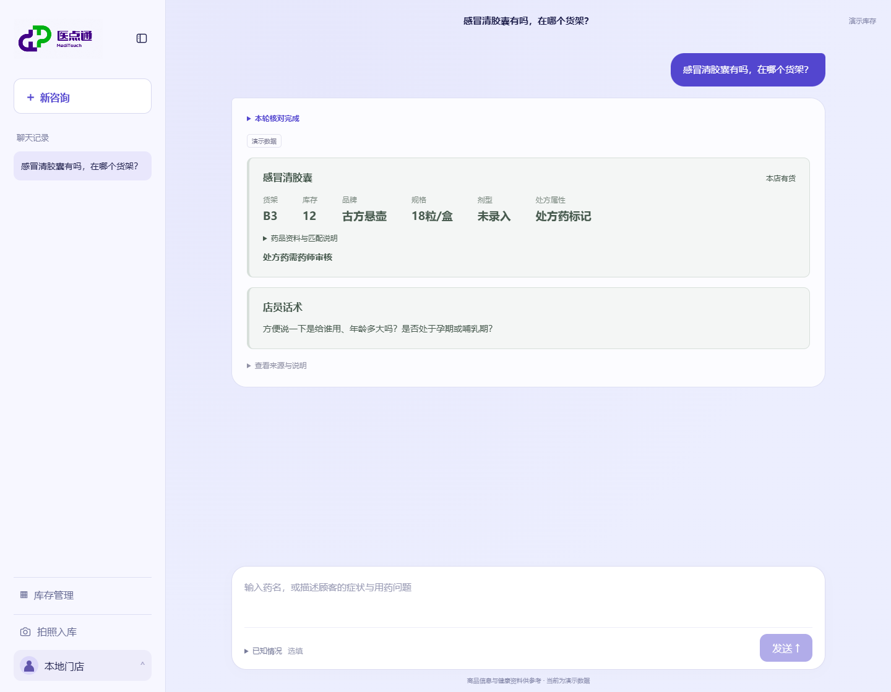
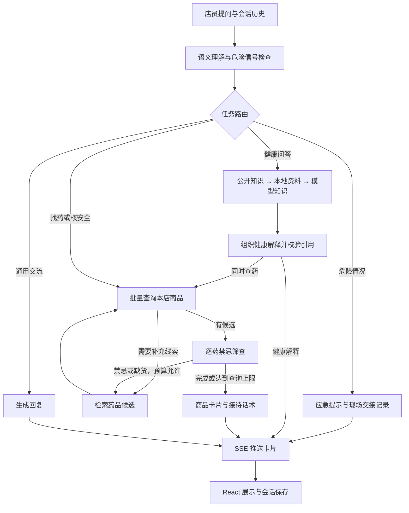

# 医点通 · MediTouch

面向实体药店店员与实习生的 Agent 工作台，覆盖健康问答、顾客接待、本店找药、药盒识别和库存管理。

系统结合会话历史理解需求，检索健康资料，查询药品货架与库存，并筛查已录入的禁忌。遇到危险表现时切换到应急处置与现场记录，帮助店员整理交接信息。

[](https://github.com/Dengzi555/meditouch-agent/actions/workflows/ci.yml)

## 功能

| 功能 | 说明 |
| --- | --- |
| 健康问答 | 查询疾病、症状及药品一般知识，按主题组织回答，突出重点并附参考来源 |
| 多轮接待 | 结合历史补全问题，识别症状、药名、人群及否认信息，通过点选追问继续补充情况 |
| 本店找药与禁忌筛查 | 查询本店药品、货架和库存，逐药筛查禁忌，携带排除清单重新查找候选 |
| 应急处置 | 优先显示呼救与条件式急救提示，记录现场情况并生成可复制的交接摘要 |
| 拍照入库 | 一张图片识别多种药品，分条预填表单，确认药品信息、货架与数量后入库 |
| 会话与恢复 | SQLite 保存聊天和图检查点，中断后继续处理；恢复库存任务时重新核验库存与禁忌 |

## 界面

**健康问答与多轮接待**


**本店药品查询**



**门店库存**


<details><summary>应急处置与现场交接</summary>


</details>

## 工作流程



### Agent 编排

LangGraph 组织健康问答、库存查询、禁忌筛查、知识补查和应急处置节点。语义入口结合会话生成独立查询，保留肯定、否认和未知信息。候选查询最多执行三轮，知识补查最多两轮，排除原因随状态保留。

健康问答按公开知识、本地资料、模型知识组织来源，生成结构化正文并校验引用。模型文本增量经 SSE 推送到前端，卡片逐帧呈现；应急提示即时完整显示。

SQLite Checkpointer 保存节点状态。恢复任务时继续原会话、原轮次，库存分支重新执行查询和筛查。[恢复机制](docs/checkpoint-recovery.md)

### 门店工具

药品工具由宿主绑定门店数据库，通过 SQLModel 查询商品、货架和库存。模型生成的候选回到本店库存匹配，再进入禁忌筛查节点。多模态识别将药盒信息预填为结构化商品资料，连接门店接待与库存业务。[工具与数据模型](docs/pharmacy-copilot.md)

## 技术栈

| 层次 | 技术 |
| --- | --- |
| Agent 编排 | Python、LangGraph、LangChain Tool Calling |
| 知识检索 | BM25、BGE 向量检索、RRF 融合、可选重排 |
| 数据与恢复 | SQLModel、SQLite、SQLite Checkpointer |
| 服务接口 | FastAPI、SSE、兼容 Chat Completions 的模型接口 |
| 前端 | React、TypeScript、Vite |
| 验证 | unittest、Vitest、Playwright、GitHub Actions |

## 快速启动

环境要求：Python 3.12+、Node.js 24。

```powershell
python -m venv .venv-agent
.\.venv-agent\Scripts\python.exe -m pip install -r requirements.txt
npm --prefix web ci
npm --prefix web run build
```

初始化本店库存并启动：

```powershell
New-Item -ItemType Directory -Force data | Out-Null
.\.venv-agent\Scripts\python.exe -c "from meditouch.inventory_models import create_inventory_engine, create_inventory_tables; create_inventory_tables(create_inventory_engine('sqlite:///data/pharmacy_inventory.db'))"
$env:MED_AGENT_INVENTORY_DB = (Join-Path (Get-Location) 'data/pharmacy_inventory.db')
$env:MED_AGENT_INVENTORY_STORE_ID = 'local-store'
$env:MED_AGENT_API_KEY = '<模型密钥>'
$env:MED_AGENT_BASE_URL = '<兼容 Chat Completions 的接口地址>'
$env:MED_AGENT_MODEL = '<模型名称>'
.\.venv-agent\Scripts\python.exe server.py
```

打开 [http://127.0.0.1:8765](http://127.0.0.1:8765/)。在“本地门店 → API 配置”中设置文本模型与独立视觉模型，保存后从下一次请求生效。公开知识与搜索接口由部署者在服务端配置。[配置说明](docs/api-settings.md)

Windows 完成配置后，可使用启动脚本：

```powershell
powershell -NoProfile -ExecutionPolicy Bypass -File scripts/start_local.ps1
```

接入门店商品时，设置对应的 `MED_AGENT_INVENTORY_DB` 和 `MED_AGENT_INVENTORY_STORE_ID`，通过入库页面录入商品，再在库存管理中维护资料与计数单位。[商品录入](docs/pharmacy-image-import.md)

前端开发：`npm --prefix web run dev`，5173端口代理后端8765端口。

## API 与目录

`POST /api/agent/stream` 接收问题和门店上下文：

```json
{
  "question": "查找布洛芬缓释胶囊",
  "workspace": {
    "store_id": "local-store",
    "task": "drug_lookup",
    "customer": { "customer_tags": ["成人"] }
  }
}
```

响应采用 `text/event-stream`，包含 `progress`、`cards.snapshot`、`done` 和 `error` 事件。[卡片协议](docs/pharmacy-ui-protocol.md)

| 模块 | 路径 |
| --- | --- |
| API 与静态页面 | `meditouch/api.py` |
| 图编排与 State | `meditouch/pharmacy_graph.py`、`pharmacy_state.py` |
| 语义理解与查询补全 | `meditouch/pharmacy_semantics.py` |
| 健康知识与引用校验 | `meditouch/health_knowledge.py`、`pharmacy_health.py` |
| 库存模型与工具 | `meditouch/inventory_models.py`、`inventory_tools.py` |
| 库存管理与入库 | `meditouch/inventory_management.py`、`inventory_import.py` |
| 应急处置与交接 | `meditouch/emergency_support.py` |
| 会话与检查点 | `meditouch/chat_storage.py`、`checkpoints.py` |
| 前端页面与卡片 | `web/src/` |
| 自动化测试 | `tests/` |

## 测试与评测

```powershell
.\.venv-agent\Scripts\python.exe -m unittest discover -s tests -t .
npm --prefix web test
npm --prefix web run build
```

自动化测试覆盖意图路由、工具调用、引用校验、流式协议、并发一致性、节点恢复和应急记录。

| 评测集 | 运行日期 | 结果 | 报告 |
| --- | --- | --- | --- |
| 100题公开资料段落检索 | 2026-11-15 | 混合 Hit@5 69.0%；重排 Hit@1 56.0% | [检索评测](docs/eval-report.md) |
| 200题合成检索回归 | 2026-11-15 | 混合 Hit@5 77.5%；重排 Hit@1 65.5% | [回归评测](docs/evaluation/retrieval-200.md) |
| 30条药店工作流场景 | 2026-11-15 | 路由 96.7%；拦截 4/6；候选全命中 16/18 | [工作流评测](docs/evaluation/pharmacy-agentic-rag-30.md) |

[评测数据汇总](docs/evaluation/evaluation-summary.json)

## 文档

[药店工作流](docs/pharmacy-copilot.md) · [健康问答](docs/pharmacy-health-qa.md) · [库存管理](docs/inventory-management.md) · [应急处置](docs/emergency-support.md) · [配置与使用范围](docs/project-scope.md)

## 许可证

代码采用 MIT License。药品资料、外部内容及品牌素材的权利归各自权利人。
