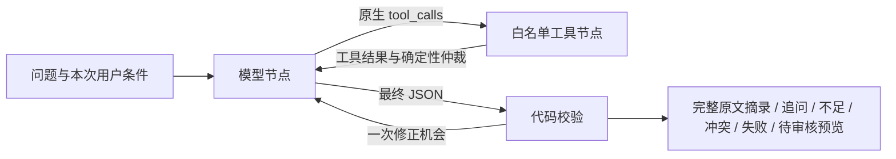

# 单 Agent 工程闭环 v0.2

日期：2026-11-02。保留原规则基线，新增 LangGraph 单 Agent 入口。

## 运行

```powershell
cd D:\demo
python -m venv .venv-agent
.\.venv-agent\Scripts\python.exe -m pip install -r requirements-agent.txt

# 已有本机 DPAPI 配置时，用 PowerShell 7 启动
pwsh -NoProfile -File .\start_with_model.ps1 -Action Agent
```

访问 http://127.0.0.1:8765 ，默认选择“单 Agent · 真实资料”。未配置模型时返回明确的模型错误，不伪造成功调用。没有 DPAPI 配置时，在启动终端配置 MED_AGENT_API_KEY、MED_AGENT_BASE_URL、MED_AGENT_MODEL，再用 .venv-agent 的 Python 运行 server.py。不要分享实际密钥或 DPAPI 文件。

原 `python server.py`、旧 `/api/chat` 和三项 MCP 工具仍保留为规则基线。新增 MCP 统一工具是 `search_materials` 和 `read_material`；LangGraph 在同一进程直接调用其共享领域服务，不套一层 MCP 子进程，也不额外调用模型。

## 实现链路



- `model_gateway.py`：兼容 Chat Completions，真正发送 tools/tool_choice，工具返回携带原调用 id。
- `evidence_service.py`：`evidence.v1` 只读契约、BM25 与旧资料适配、原文偏移核验、PDF 哈希核验、显式主张关联补召回、仲裁与校验。
- `agent_graph.py`：StateGraph 的 model/tools/validate 节点和条件边。
- `agent_acceptance.py`：离线脚本模型验收、真实模型验收、ping 往返及真实资料预览检查。
- `test_agent_graph.py`：契约与循环的针对性回归。
- `test_agent_http.py`：隔离数据库下的HTTP调用、持久化及无效参数检查。

主 Agent 工具：`search_evidence(question,k)`、`get_evidence(evidence_id)`、`ask_user(fields)`。真实/演示语料由请求端选择，模型不能更改语料源或审核状态。读取原文只允许本次已经检索到的 ID，并复用本次快照。

默认最多5次模型调用、6次工具调用、90秒；兼容接口每次最长35秒、无内部自动重试。同一暂时失败调用最多2次尝试，成功调用重复时停止。校验失败最多修正一次。终止、重试和模型/工具异常都进入轨迹；不保存模型未校验的最终草稿或模型内部推理。

## 追问及状态

目前仅用小范围规则识别个体适用问题：涉及本人/家人且询问是否可以、适合或应该时，要求人群字段；涉及补钾/低钠盐时额外要求肾功能情况。这不是通用医学分诊。

缺失必需条件时，宿主强制首选 ask_user，模型不能绕过。网页可在“补充适用条件”中填写后重发原问题。条件是用户本次声明，未验证；没有自动长期记忆、跨用户档案或持久 checkpointer。不要把本次状态存储说成完整健康档案。

## 审核和回答校验

真实指南保留 pending。文档 manifest 和检索块必须都为 approved，且块的 generation_allowed=true，才进入可回答证据；没有自动审核或发布工具。演示种子也不因进入 Agent 而自动变为 approved。

当前采用严格抽取式输出：模型只选择 evidence_id 和完整 raw_quote。代码拒绝未知引用、旧版本、待审核条目、快照变更、截短/改写原文和任意新增字段。显示文本由宿主渲染，模型自由改写不进入回答。

这个选择避免“引用存在但医学结论被改写”的一类错误；仍不证明相关性、个体适用性、医学正确性或全文无冲突。完整章节可能很长，后续要在保留条件和例外的前提下设计更细引用单元，而不是直接放宽截取规则。

结构化主张按明确主题、人群、条件分组，只有有效日期与显式替代关系可以排除历史版本。同范围关联主张会补召回，不受初始 top-k 截断。未经结构化的全文分歧、同义条件和复杂否定仍可能漏检。

## 验收

```powershell
# 14项新增单元测试，含5类离线验收与HTTP集成
.\.venv-agent\Scripts\python.exe -B -m unittest test_agent_graph test_agent_http -v
.\.venv-agent\Scripts\python.exe -B agent_acceptance.py

# 真实模型：消耗接口额度；只用虚构工程证据
pwsh -NoProfile -File .\start_with_model.ps1 -Action AgentCheck
pwsh -NoProfile -File .\start_with_model.ps1 -Action AgentEval

# 真实公开资料：检索结果发送给配置模型，仅原文预览
pwsh -NoProfile -File .\start_with_model.ps1 -Action AgentPreview

# 原回归与真实 MCP SDK 协议测试
.\.venv-eval\Scripts\python.exe -B -m unittest -v
.\.venv-craft\Scripts\python.exe -B check_craft_mcp.py
```

2026-11-02实际结果：

| 验收 | 结果 | 范围 |
| --- | --- | --- |
| ping 往返 | 通过，2次模型调用、1次工具执行 | 工具结果包含首轮响应后生成的 receipt，模型确实消费结果 |
| 正常问答 | 通过 | 内存内已审核的虚构测试资料，引用校验通过 |
| 需要追问 | 通过 | 实际调用 ask_user，缺失条件不能被模型绕过 |
| 证据不足 | 通过 | 空语料，停止输出医学结论 |
| 证据冲突 | 通过 | 保留双方及适用条件，执行确定性版本排除 |
| 工具失败 | 通过 | 合成超时，有限重试后明确失败 |
| 真实指南预览 | 通过 | 真实模型调用本地真实检索，状态 pending_review，未擅自审核 |

第一轮真实验收为4/5：追问场景被宿主拦截，但模型先进行了检索，没有调用 ask_user。修正提示优先级及必需条件强制工具选择后，第二轮为5/5。没有用离线脚本模型冒充真实模型成绩。

测试使用真实模型的5个开发场景，不是独立医学评测集或稳定性统计。每次真实运行都可能不同；不得宣传“医学准确率100%”。

结果文件位于忽略的 data/：agent-ping.json、agent-acceptance-live.json、agent-acceptance-offline.json、agent-real-preview.json。CLI 新运行同时保存带时间与随机后缀的报告，不覆盖历史归档。轨迹使用合成资料，不记录凭据。真实网页请求保存在原 runs 表，包含问题与证据，应按敏感数据处理。

新增14项测试全部通过；原19项测试仍通过。在 .venv-eval 中发现33项测试，其中9项 graph/HTTP 测试因环境未装 LangGraph 跳过；这些9项已在 .venv-agent 实际执行通过。两环境合计覆盖全部33项不同测试，没有把跳过计为通过。MCP stdio 初始化、5工具、统一契约和只读校验通过。

HTTP集成测试还暴露了旧服务的SQLite连接未及时关闭：事务上下文退出不等于关闭连接。本轮将server.connect改为显式关闭的上下文管理器；隔离库写入、查询与清理均已回归通过。

## HTTP

`POST /api/evidence/search`：question、k（1—8）、corpus（real/demo）；返回 evidence.v1。

`POST /api/agent`：question、corpus（默认real）、known_context（可选，仅population/renal_function）。不接受客户端注入审核状态或文档路径。

返回包括 status、answer、sources、citations、arbitration、validation、trace、model_calls、tool_calls、errors、missing_context。状态有 answered、needs_clarification、insufficient、unresolved、pending_review、tool_error、model_error、budget_exceeded、validation_failed。

目前 trace 便于本机审计，可能包含完整原文，不适合直接暴露到公网。单机无认证的原型仍需后续建设身份隔离、访问控制与数据生命周期。

## 依赖与参考

本轮使用 LangGraph 1.2.19，直接依赖固定在 requirements-agent.txt；现有 MCP/Claw-Eval 环境未改变。首次克隆不会包含本地真实语料、DPAPI、虚拟环境或数据库，需独立准备；真实语料缺失时返回 CORPUS_UNAVAILABLE，不自动下载或伪造资料。

StateGraph 循环依据官方 quickstart：https://github.com/langchain-ai/docs/blob/main/src/oss/langgraph/quickstart.mdx 。该实现自定义工具节点以执行白名单、预算和确定性领域约束，没有引入多 Agent。
