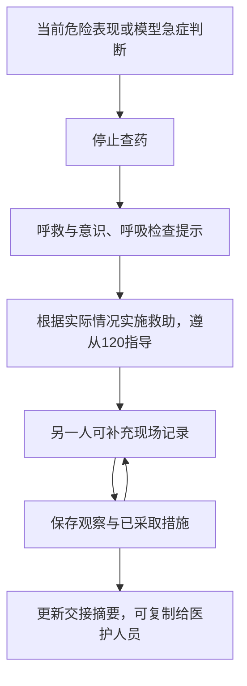

# 应急处置与交接记录

急症分支停止库存查询和药品推荐，但继续提供现场处置提示与记录。指引由宿主代码立即生成，不等待模型，不播放逐字动画。



## 使用

输入当前危险表现，例如“顾客现在嘴歪、言语不清怎么办”。卡片首先展示呼救、呼吸判断和条件式救助动作。无需填写任何字段即可查看全部指引，拨号链接不会自动标记已呼救。

记录意识、呼吸、是否已呼救三个选项；有余力时再补充症状开始时间、最后正常时间、地点、年龄、病史、已用药和已实际采取的措施。点击“更新记录”后，交接摘要更新；有未保存修改时禁止复制旧摘要。发病时间和记录时间分开，未知不推断为正常或未用药。

无反应且没有正常呼吸（包括仅喘息）时才确认心肺复苏条件；无反应但正常呼吸显示恢复体位提示，包含疑有头颈/脊柱损伤时避免随意搬动的限制。卒中警示表现提示不自行喂食、给药或快速降压，记录最后正常时间，不在店内区分脑出血或脑梗。

## 保存与隔离

`POST /api/chats/{session_id}/turns/{turn_id}/emergency` 接收门店、`expected_revision` 和允许的观察字段。服务端从原会话重建处置卡和摘要，不接收客户端编造的诊断或处置指令。不调用图、不查库存、不新增聊天轮次。

只允许当前身份、门店下最新一轮已完成的应急记录更新。事务与版本号防止两个页面互相覆盖；409时重新打开会话。数据保存在原聊天数据库，刷新或服务重启后仍可读取。最近30次更新保留时间与变更字段，历史轮次只读。暂无多人接诊、自动呼救或医院系统对接。

## 来源与范围

2026-11-15核对：

- [北京市卫生健康委员会：如何正确呼叫120](https://www.beijing.gov.cn/fuwu/bmfw/jhsyfwzdzx/2021nsjrkr/2021sjrkrjkzs/202107/t20210707_2431055.html)
- [ANZCOR：基础生命支持](https://www.anzcor.org/home/basic-life-support/guideline-8-cardiopulmonary-resuscitation-cpr)
- [ANZCOR：卒中识别与急救](https://www.anzcor.org/home/first-aid/guideline-9-2-2-stroke)
- [Stroke Foundation：等待救护车时的处理](https://strokefoundation.org.au/About-Stroke/Learn/signs-of-stroke/What-to-do-while-you-wait-for-an-ambulance)

使用中国大陆急救号码120；国外来源中的本地电话号码不沿用。当前实现为通用生命支持提示及卒中警示的有限分支，不是所有急症的专病处置系统，不代替120调度指导。测试验证代码分支、记录持久化与查药阻断，不代表临床效果验证。

```powershell
.\.venv-agent\Scripts\python.exe -B -m unittest tests.test_emergency_support -v
```
