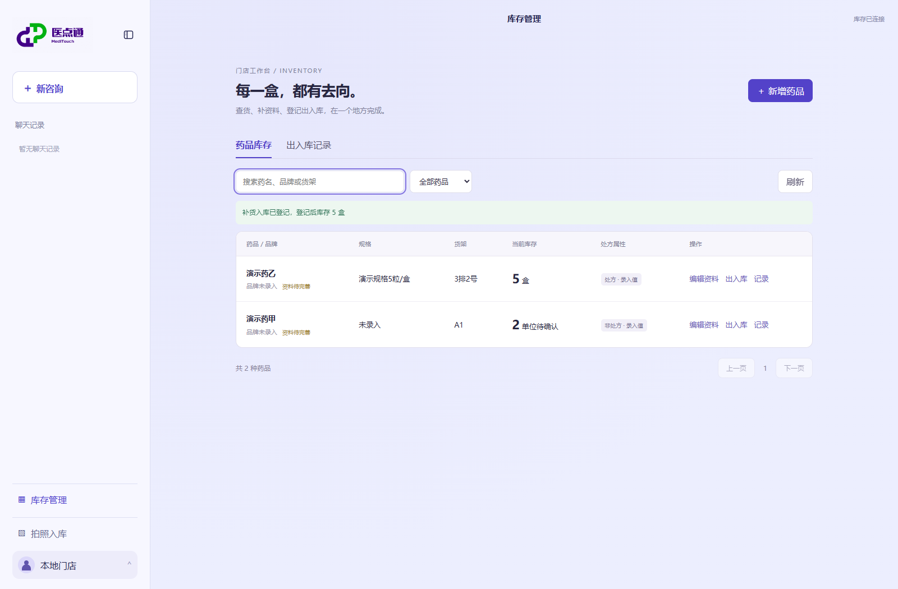

# 库存管理

侧栏进入「库存管理」，所有已入库药品共用本店 SQLite 数据库。药品列表支持按药名、品牌、货架搜索，以及缺货、资料待完善筛选；新增药品复用拍照识别与手动确认表单。

## 资料与数量分开管理

- 「编辑资料」维护药名、品牌、货架、规格、剂型、处方标记、成分和禁忌原文，不接受 stock 字段。
- 旧数据未记录计数单位，首次出入库前须人工确认盒、瓶、支等单位；选择单位不会换算现有数量。
- 「出入库」支持销售扣减、补货增加、退货增加和盘点调整。盘点填写实有数量，其他类型填写本次数量。
- 每笔登记必填原因，记录操作前后数量、单位、时间、商品名快照及本地演示操作人。
- 历史库存作为期初余额；本功能不会伪造旧销售记录。新品首次确认入库的数量同样是该商品期初余额。
- 已发生出入库的商品不能直接改变计数单位；销售登记仅记账，不代替处方或用药审核。

## 一致性

登记时使用 SQLite `BEGIN IMMEDIATE`、预期库存与版本检查，交易记录和库存更新在同一事务提交。库存不足、过期快照或写入失败均不扣库存。`request_id` 相同且内容一致时返回原记录，不重复扣减；同编号不同内容返回 409。

聊天检索仍为只读，下一次查询读取同一份最新库存。已保存的聊天卡片属于当时的查询快照，不充当当前库存凭据。跨窗口改动可点击库存页「刷新」重新获取；后端始终在登记时复查。

附加表 `inventory_control`、`stock_movement` 在首次访问管理接口时创建，不修改或清空原有药品表。当前仅面向单店本地 Demo，未接入收银订单、批号效期、员工权限、退货质检或财务结算；退货是否可再次销售由店员人工确认。

## 接口

| 方法 | 路径 | 用途 |
| --- | --- | --- |
| GET | `/api/pharmacy/inventory?store_id=…&q=…&status=all` | 分页药品列表；status 支持 out、incomplete |
| POST | `/api/pharmacy/inventory/{id}/edit` | 显式编辑资料，携带 expected_version |
| POST | `/api/pharmacy/inventory/{id}/movements` | 显式登记，携带 request_id、expected_stock、expected_version、kind、quantity、reason |
| GET | `/api/pharmacy/inventory/movements?store_id=…` | 分页记录，可按 inventory_id、kind 筛选 |

写接口均校验门店绑定与请求来源，不提供给模型调用。

## 验证

```powershell
python -m unittest tests.test_inventory_management -v
```

浏览器验收脚本 `scripts/check_inventory_management_ui.py` 连接 8767 端口的隔离夹具服务 `scripts.pharmacy_ui_fixture`，只操作临时合成库存，不访问正式门店库存。


