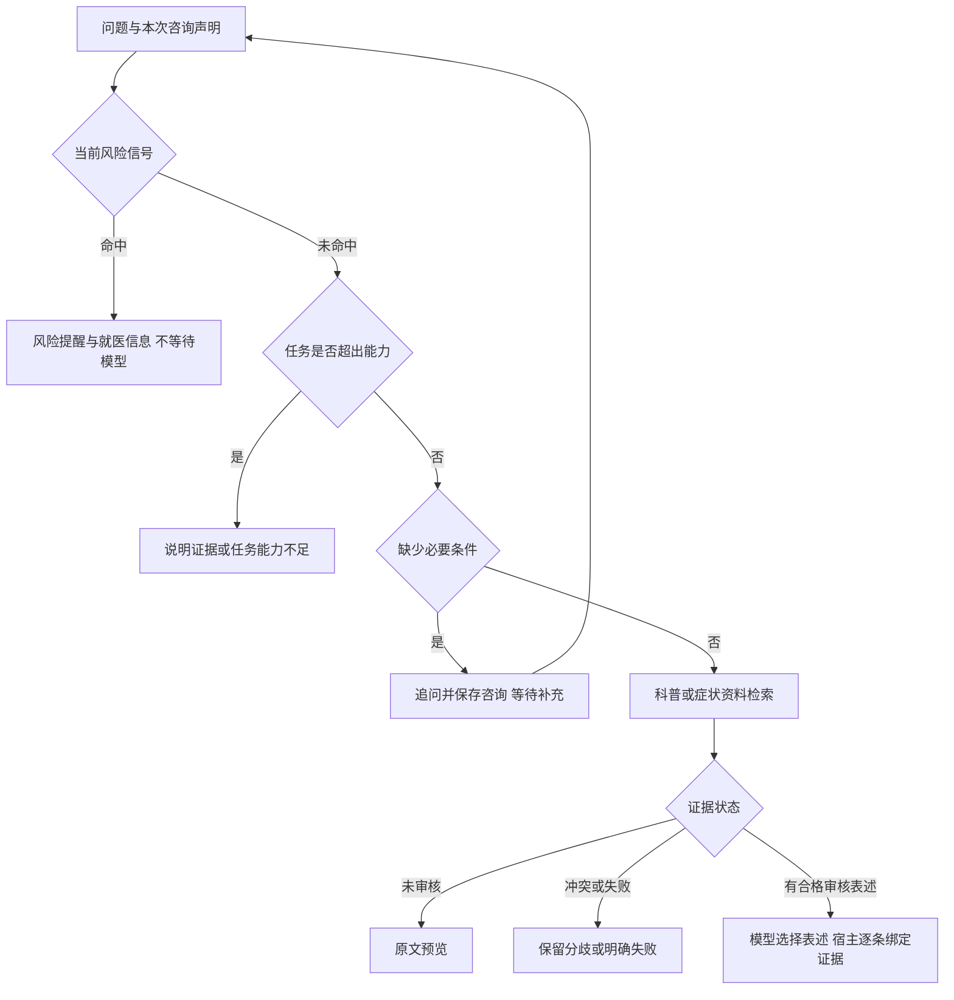

# 症状咨询流程、审核表述生成与五类验收

日期：2026-11-02。实现范围是本机工程原型，不是医学金标准、完整临床分诊或上线审批。

## 咨询流程

`meditouch/consultation_flow.py` 在模型、追问和检索之前进行路由：



可用状态为 `risk_alert`、`needs_clarification`、`insufficient`、`pending_review`、`unresolved`、`tool_error`、`answered` 等。`flow.kind` 区分risk、clarification、insufficient、education、consultation。会话恢复使用同一套路由，风险提示恢复后不再显示一长串待填问题。

风险规则只对少量明确表述作保守提示，记录命中规则和文字片段；否定、假设、历史及部分未知描述分别处理。规则参考[中国疾控中心公开就医信号](https://www.chinacdc.cn/jkkp/crb/qtcr/202605/t20260511_1835710.html)和[NHS呼吸困难危险信号](https://www.nhs.uk/symptoms/shortness-of-breath/)，界面不使用英国急救号码。规则本身尚未由临床人员审核，也不是完整症状理解模型；存在漏检及误报，未命中绝不表示安全。没有建立严重度评分、诊断或个体处方工具。

个体确诊、猜产品成分、决定停药和现有资料不支持的实时数据等进入不足出口；需要关键背景时仍可先收集信息。未知值不转换为“无异常”。一般防护/疾病区别问题不要求患者提供完整个人信息。

## 经审核内容的受限生成

`meditouch/reviewed_content.py` 把医学审核记录绑定到具体证据ID、完整原文和原始快照指纹。每条审核记录包含患者表述patient_text、适用范围、限制、不确定性、审核人和日期。只允许 `general_education`；个体处方范围不被接受。

目前真实资料仍无临床审核通过的记录。已生成本地30单元模板 `data/review-template-20261102.json`，均为pending，供专业人员核对和填写。本次没有把下载资料或模型自评冒充医学审核。

```powershell
# 导出新的待审模板（不会覆盖已有文件）
python -B -m meditouch.reviewed_content template data/review-template-new.json
# 专业审核完成后，检查审核记录与当前原件是否仍一致
python -B -m meditouch.reviewed_content check data/completed-reviews.json
# 明确安装有效审核记录；原注册表有备份，并留下本机安装日志
python -B -m meditouch.reviewed_content install data/completed-reviews.json
```

注册表位于Git忽略的 `data/reviewed-content.json`。安装是开发者CLI动作，没有暴露给Agent、HTTP导入文档工具或MCP工具。审核人身份在本机记录，尚未认证；不能把这个文件机制当作正式机构的审批系统。有权限同时修改源码、原件和注册表的人仍可篡改内容，需要部署层的访问控制另行治理。

模型检索到reviewed_statements后只能输出statement_id列表。宿主按审核文本原样组合回答，每条同时给出处、适用条件和限制；模型不能自由改写或补充医疗事实。引用保留完整原文用于核对。未知ID、额外编造文本、来源改变、撤销或范围不符时阻断；最多一次修复。真实语料未导入合格记录前仍只预览。旧抽取式协议保留用于原有工程夹具，审核表述存在时必须走新协议，不能绕回自由输出。

这种方案约束事实来源及措辞，尚不证明表述与问题语义相关、适用于具体用户或医学正确。当前不自动作病因判断，不生成置信度百分比，也不以投票替代事实仲裁。界面展示用户信息未核实及仍未知的字段。

## 五类验收与40个开发问题

新增 `scripts/patient_acceptance.py`，分别报告两部分：

1. 五类工程场景：正常问答、需要追问、证据不足、证据冲突、工具失败。正常回答使用显式的虚构审核表述夹具，不涉及真实病情；测试引用绑定及限制保留。可用真实模型验证工具往返。
2. 原40个合成问题：由 `eval_data/patient_flow_expectations.json` 提供逐题、人工编写的工程预期，不从被测route函数直接计算预期。普通查询使用真实待审语料，冲突、引用错误和工具失败明确注入夹具。风险案例检查零模型调用且优先停止；资料待审只能预览。这不是独立医学测试集，不能从流程通过推导临床可靠性。

```powershell
# 不调用付费模型
.\.venv-agent\Scripts\python.exe -B -m scripts.patient_acceptance
# 当前配置的真实模型运行五类工程场景；40题仍用脚本模型检查流程
pwsh -NoProfile -File start_with_model.ps1 -Action PatientEval
```

本机已执行：离线五类5/5；真实模型五类5/5；40题开发流程40/40。真实模型验收不代表用真实患者验证，也不代表40题都调用了真实模型。

报告保存为 `data/patient-acceptance-offline.json`、`data/patient-acceptance-live.json` 及带时间戳归档。失败试跑报告也保留，没有通过后覆盖掉历史归档。界面“质量评测”按钮通过 `/api/patient/evaluate` 执行脚本模型的五类与40题验收，不消耗模型API调用；原 `/api/evaluate` 的规则基线仍可调用。

新增 `tests/test_patient_flow.py` 覆盖风险优先及否定/假设/历史、审核记录与来源绑定、撤销/篡改阻断、禁止模型改写、五类与40题。HTTP测试另覆盖风险结果刷新恢复及新验收端点。

## 仍需外部材料或专业工作

- 真实患者表述需医生/药师核对来源、适用性和遗漏条件，并提供可追溯的审核记录。当前真实审核通过仍为0。
- 风险提示需要临床人员审查、扩展症状范围，并在有代表性的独立数据上测漏检和误报。
- 自动自然语言冲突检测、问题相关性与个体适用性评测尚未完成；现有仲裁仍以显式结构化claims为基础。
- 鉴权、数据保护和正式部署仍不在本机原型当前能力内。
