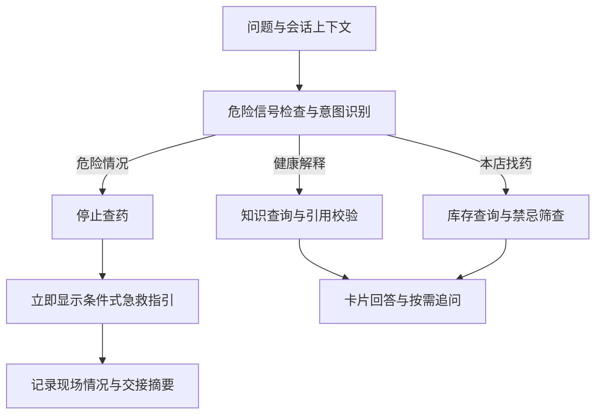

# 症状理解与风险路径

## 语义理解

`meditouch/pharmacy_semantics.py`结合问题、当前会话历史和顾客声明，输出意图、独立问题、症状、否认症状、人群标签和目标药名。

- 五类意图：`health_qa`、`find_drug`、`check_safety`、`emergency`、`chitchat`。
- `standalone_query`补全省略的主题和指代；`context_resolution`记录补全状态。
- 肯定、否认和未知分别保留；更换顾客时重新确定适用的上下文。
- `needs_health_answer`和`needs_inventory`分别控制知识解释与本店查询。

## 风险优先

`meditouch/risk.py`检查当前危险表现，处理否定、假设和历史描述。明确风险可以在模型不可用时直接进入应急节点。模型识别出的急症同样进入危险路径。



应急节点的动作提示立即显示，现场记录由店员确认后补充。意识和呼吸状态未知时保留未知；指引展示和实际采取的措施分别记录。详见[应急处置](emergency-support.md)。

## 验证

自动化测试覆盖意图理解、历史承接、危险分支零查药调用、条件式处置提示、记录持久化和会话隔离：

```powershell
python -m unittest tests.test_pharmacy_rewrite tests.test_emergency_support tests.test_checkpoint_recovery
```

工作流评测按找药、禁忌筛查、联合用药、缺货和急症五类场景统计，运行信息与逐类结果见[工作流报告](evaluation/pharmacy-agentic-rag-30.md)。
