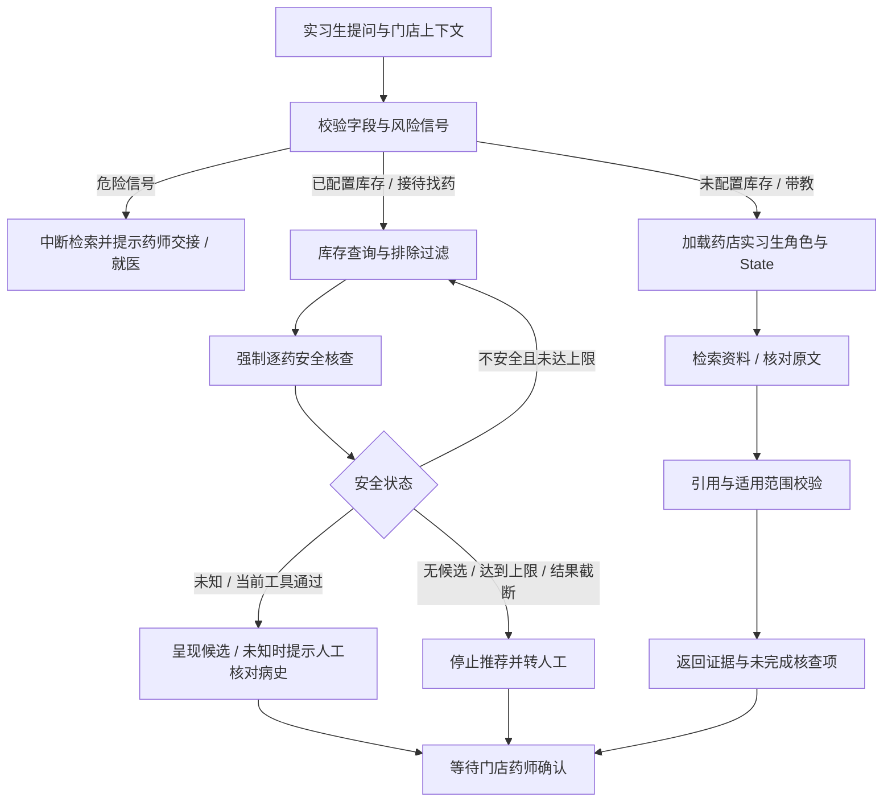

# 药店实习生 Copilot

面向门店实习生，辅助顾客接待、找药、安全核查与实战带教。最终售药判断交门店药师处理。

## 当前交付范围

默认入口为 FastAPI + React，支持接待、找药和安全核查。LangGraph 先理解原问及聊天历史，再按急症、闲聊、库存查询分支执行；不经过原 C 端患者信息表单。此网页入口暂不支持独立带教任务。

库存查询与禁忌文本筛查工具通过宿主绑定的 engine 连接 SQLite。真实门店需自行导入并核对商品数据；演示种子存放在单独 Mock 库，不能当作真实说明书。没有完整配伍核查来源，安全未知不等于允许售药。未配置库存时返回配置提示；明显急症仍可绕过数据库发出风险提示。

原 NDJSON 流接口已退役，响应使用 SSE 卡片快照。会话通过 SQLite 保存并可恢复，当前仍为单店本地演示身份，未实现员工登录与权限管理。库存管理支持显式编辑资料及出入库事务，不向模型暴露写库存工具。[库存操作](inventory-management.md) · [多轮语义理解](pharmacy-semantic-workflow.md)。

## State 分层

| 状态 | 内容 | 写入来源 |
| --- | --- | --- |
| `audience` | `pharmacy_intern` | 宿主程序 |
| `workspace.store_id` | 本次请求的门店标识，尚未做权限认证 | 调用方 |
| `workspace.task` | 接待、药品查询、安全核查、带教 | 调用方 |
| `workspace.customer` | 年龄、人群、症状、否定症状、过敏、现用药、既往史、目标药品、处方转述 | 实习生声明 |
| `pharmacy_workflow.inventory` | 连接状态、商品结果、查询时间 | 宿主；当前未接入 |
| `pharmacy_workflow.safety` | 核验状态、检查结果、缺失信息 | 宿主；当前未核验 |
| `pharmacy_workflow.handoff` | 交接要求、确认状态、是否放行 | 宿主；当前等待确认且不放行 |
| `pharmacy_workflow.teaching` | 可用证据 ID | 宿主引用校验结果 |
| 原执行状态 | 消息、原文证据、轨迹、预算、错误和修复次数 | 原图节点 |
| `inventory_results` | 本轮库存候选，每次查询覆盖，避免累加旧候选 | 库存节点 |
| `safety_status` / `safety_reason` | `safe`、`unsafe`、`unknown` 与原因 | 安全节点 |
| `excluded_drugs` | 本次流程内已命中禁忌的药名 | 安全节点，去重后保留 |
| `excluded_reasons` | 各排除药品对应的原始筛查原因，跨重查保留 | 安全节点 |
| `inventory_attempts` | 库存查询轮数，含首轮，最多3轮 | 库存节点 |
| `customer_tags` / `extracted_entities` | 明确标签与查询实体，不含数据库参数 | 宿主声明或一次模型提取 |

顾客未知信息不补成“无”；输入字段不能注入库存、安全通过或审批状态。`answered` 只代表资料回答通过引用校验，不代表配伍安全或允许售药。

## 执行路径



## 调用示例

先在 `web` 执行 `npm ci`、`npm run build`，再运行根目录 `server.py`。`POST /api/agent/stream`（或 `/api/pharmacy/copilot/stream`）返回 SSE：

```json
{
  "question": "顾客想了解布洛芬的用药注意事项，请帮我核对资料",
  "workspace": {
    "store_id": "demo-store-01",
    "task": "safety_check",
    "customer": {
      "age": "30岁",
      "population": "成人",
      "allergies": "不清楚",
      "requested_drug": "布洛芬，规格未确认"
    }
  }
}
```

也可直接调用 `run_graph(question, workspace={...})`。不传 `workspace` 时仍兼容原 C 端行为；B 端不能同时传 `known_context`，防止两套顾客信息互相覆盖。

测试：`python -m unittest tests.test_pharmacy_context tests.test_agent_http -q`。使用离线模型与合成证据验证工程契约，不代表药学或售药安全评估。

## 后续接入顺序

### 轻量库存模型

`meditouch/inventory_models.py` 已定义 SQLModel 主表 `drug_inventory` 和扩展表 `drug_details`，字段按轻量录入设计。主表无需扩展表即可存在；扩展表的 `inventory_id` 同时设置外键及唯一约束，保证一对一。库存不能为负，药名、货架不能为空。

依赖安装：`python -m pip install -r requirements.txt`。显式初始化及录入示例：

```python
from sqlmodel import Session, select
from meditouch.inventory_models import (
    DrugInventory, DrugDetails, create_inventory_engine, create_inventory_tables,
)

# 当前是一店一库；不要把多店数据混入该表后再按名字查询。
engine = create_inventory_engine('sqlite:///data/pharmacy_inventory.db')
create_inventory_tables(engine)  # data/ 目录需预先存在；不会迁移已有表结构

with Session(engine) as session:
    drug = DrugInventory.model_validate({
        'name': '布洛芬缓释胶囊',
        'brand': '芬必得',
        'shelf_location': '3排2号',
        'stock': 0,
    })
    session.add(drug)
    session.commit()
    session.refresh(drug)
    # 详情可之后补充；这里不录入未经核对的医学内容。
    session.add(DrugDetails(inventory_id=drug.id, dosage_form='胶囊'))
    session.commit()
    matches = session.exec(select(DrugInventory).where(DrugInventory.name == drug.name)).all()
```

- OCR/手动输入使用 `model_validate()`，触发字段校验与首尾空白清理。普通 ORM 构造不能替代输入校验；数据库另有关键约束。
- `stock` 单位约定为最小销售包装，不能混用“盒”和“粒”。药名不唯一，同名商品按独立 ID 区分；缺少规格时不能据名字自动认定为同一商品。
- `created_at` 在 Python 中按 UTC 生成；SQLite 回读时间可能不附时区，仍按 UTC 解释。
- `is_rx=False` 按要求作为录入默认值，**不能据此认定已确认非处方属性或自动放行**。OCR 未识别的信息需要后续核对。
- `contraindications` 缺失代表未知；简写仅供展示，不能替代完整说明书或作为完整配伍核查依据。
- 模型和工具均不自动创建真实库存、导入商品或授权售药。

### 库存与禁忌筛查工具

完整代码位于 `meditouch/inventory_tools.py`，使用 `langchain_core.tools.tool` 包装，Docstring 和类型提示生成模型可读描述与参数。宿主绑定门店数据库；模型无法指定数据库路径或切换门店。

```python
from meditouch.inventory_models import create_inventory_engine
from meditouch.inventory_tools import build_inventory_tools

engine = create_inventory_engine('sqlite:///data/pharmacy_inventory.db')
# 数据库需先按前例建表并导入真实数据；工具只查询，不负责建表。
search_inventory, check_drug_safety = build_inventory_tools(engine)

stock = search_inventory.invoke({'drug_name': '布洛芬'})
candidate = search_inventory.invoke({'symptom': '发烧'})
safety = check_drug_safety.invoke({
    'drug_name': '布洛芬缓释胶囊', 'customer_tags': ['孕妇'],
})
tools = [search_inventory, check_drug_safety]
```

库存按药名或品牌模糊匹配，详情使用 LEFT JOIN，确保没有详情的主表商品仍可返回。两个查询条件同时提供时取交集。内置的“发烧／发热”映射仅筛选药名或成分候选，不构成治疗建议，不推断儿童或孕妇适用性。映射参考 [NHS 成人发热资料](https://www.nhs.uk/symptoms/fever-in-adults/)，不能替代具体产品说明书。宿主可用 `symptom_terms={...}` 完整覆盖默认词典；未支持症状会明确返回状态，不查询全店。

安全工具优先完整药名/品牌精确匹配，未命中才模糊查询。多条商品返回 `ambiguous`，不自动挑选一个规格。禁忌缺失、标签为空、未命中、商品不存在或数据库故障全部返回 `is_safe="unknown"`，禁忌文本命中则为 `false`，从不返回 `true`。该筛查只做字面匹配，无法解析禁忌中的否定、条件和适用阶段，更不覆盖药物相互作用；命中项也需药师复核。

每条候选商品独立标记 `out_of_stock` 或 `in_stock`；处方药附 `warning="处方药需药师审核"`。最多返回50条并显式提示截断。库存是查询时快照，不锁货、不扣库存，也不保证稍后仍有货。

独立测试：`python -m unittest tests.test_inventory_tools -v`。执行图测试：`python -m unittest tests.test_pharmacy_graph tests.test_agent_http -v`。

### 启用库存执行图

已有本店库存数据库时，在启动服务的同一个 PowerShell 进程里设置：

```powershell
$env:MED_AGENT_INVENTORY_DB = 'D:\demo\data\pharmacy_inventory.db'
$env:MED_AGENT_INVENTORY_STORE_ID = 'demo-store-01'
.\.venv-agent\Scripts\python.exe server.py
```

环境变量里的门店标识必须与请求 `workspace.store_id` 一致。数据库以 SQLite `mode=ro` 打开，路径不接受客户端指定，不会自动创建空库。当前是单店 demo 标识匹配，不是员工授权系统。已有服务需要在设置变量后重启。

`POST /api/agent/stream` 的 `workspace.customer` 可传 `requested_drug`、`symptoms` 和 `customer_tags`（最多20项文本）；可选 `history` 接受当前聊天的最多20条 user/assistant 消息。统一语义入口结合原问、声明和历史输出四类意图、多症状、多药名、人群与否认症状；急症先拦截，解析失败转人工，不猜药。详见[当前多轮流程](pharmacy-semantic-workflow.md)。

核心构建代码在 `meditouch/pharmacy_graph.py`。也可直接绑定 engine：

```python
from meditouch.agent_graph import run_graph

result = run_graph(
    '查找本店药品', inventory_engine=engine,
    workspace={'store_id': 'demo-store-01', 'task': 'drug_lookup',
               'customer': {'requested_drug': '布洛芬缓释胶囊', 'customer_tags': ['孕妇']}},
)
```

每轮库存结果覆盖旧结果；排除列表、缺货记录和 trace 跨重查保留。批量候选在 SQL 和宿主再次过滤排除药。库存无匹配时可以进入知识补查；有候选时必须进入 `safety_node`。禁忌拦截、缺货或部分药名未匹配时，可按症状、人群和排除清单重新找候选；最多三轮库存、两次知识补查。候选过多或工具异常转人工，不能把检索到的替代线索当成已确认同效或无禁忌。

`unknown` 必须输出“请人工核对病史”，不走模型自由改写。`safe` 只有全部候选明确返回 Python `True` 且有顾客标签时才可达；当前文本筛查工具从不返回 `True`，因此真实链路不会因为未命中禁忌就判为安全。即使未来接入可返回 `True` 的核验器，处方提示和药师交接仍保留。

### 店员带教回答

`meditouch/pharmacy_generation.py` 包含新的 `GENERATOR_SYSTEM`、`build_generator_messages` 和分支渲染。角色采用资深药师的带教口吻，不声称模型有真实执业资质或20年从业经历。

上下文使用 `SystemMessage` 和 `HumanMessage`。HumanMessage 以 JSON 保留原问题、药名/货架/库存等候选字段、被排除药、逐药排除原因、当前安全状态和原因，并附顾客标签与核查明细。传给现有 `ModelGateway` 时转换为兼容 Chat Completions 的 system/user 字典。

- **禁忌数据缺失**：输出【风险提示】【拿药指引】【店员话术】，固定包含“系统未收录该药禁忌数据，请务必询问顾客是否有相关病史。”及“请人工核对病史”。
- **其他 unknown**：保留实际原因，例如未命中标签或核查失败，不一概谎称未收录数据。
- **重查后的候选**：先展示被排除药及历史原因，再展示【候选替代（待核）】；原先不安全不代表新候选已安全。
- **当前仍 unsafe**：拦截并转人工，不将当前候选作为替代药。
- **safe**：展示当前工具通过的候选，保留处方警示、药师确认和不自动放行的边界。
- **空列表**：区分未匹配、查询失败和排除后无剩余候选；只有实际 `stock=0` 的商品才报告缺货。调货或采购作为工作建议，不生成未查询的替代药。

LLM 每次最多增加一次话术选择调用：只允许返回预置话术编号，药品事实和安全分支由宿主渲染。未授权的编号、额外自由文本、伪造药品或格式异常均丢弃，模型不可用时使用固定话术。空列表、仍不安全和全部缺货分支直接输出，不消耗生成调用。`generation_status` 与模型调用数计入结果与 trace。该实现不是任意医学文本生成器。

测试：`python -m unittest tests.test_pharmacy_generation tests.test_pharmacy_graph -v`。

卡片输出与 SSE/React 实现见 [UI 协议](pharmacy-ui-protocol.md)。默认网页已使用 React 卡片与 SSE Hook；原 NDJSON 实现已删除。独立合成演示服务仍保留在 examples 中，不作为默认入口。

### 后续工具与数据接入

1. 接门店商品表：SKU、通用名、商品名、成分、剂型、规格、货架号、库存和更新时间；服务端绑定门店权限。
2. 增加只读找药工具：按成分、剂型和规格筛选；候选商品必须来自工具返回，库存变化需重新查询。
3. 接产品说明书和配伍核查来源，输出具体证据、适用条件及未覆盖项；特殊人群和处方问题进入药师交接。
4. 做药师确认接口与操作记录，再接门店会话和实习生页面。确认状态由有权限的服务端操作写入。
