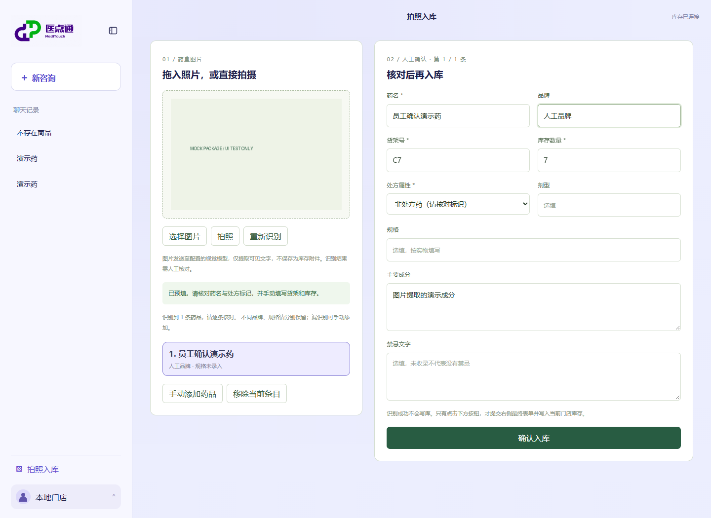
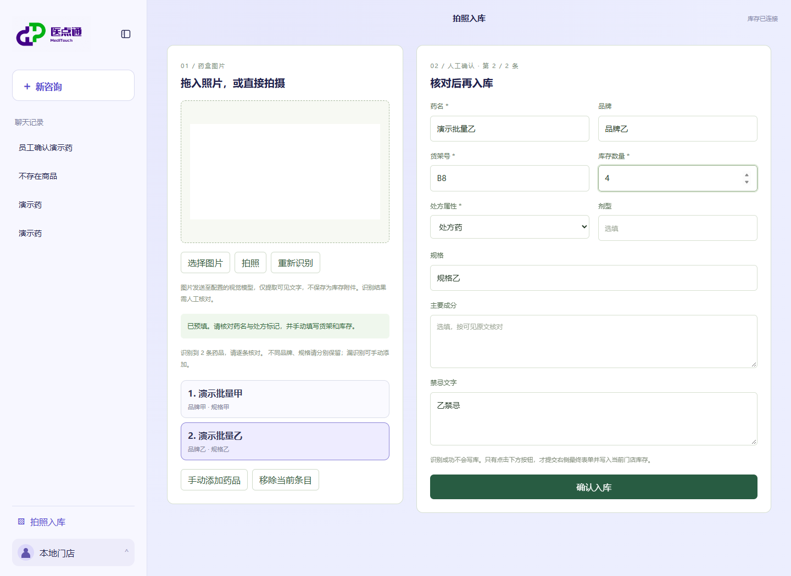

# 图片预填与人工确认入库

页面新增“拍照入库”：左侧选择、拖拽或移动端拍照，右侧编辑表单。桌面端的拍照按钮可由浏览器退化为文件选择。图片仅用于本次识别，不存成库存附件。

支持一张图中的多种药品：识别后左侧显示待入库列表，右侧编辑当前条目。逐条确认后自动进入剩余条目，未提交内容保留；可手动添加漏识别药品、移除误识别条目。





截图使用合成图片和脚本视觉模型验证界面，不代表真实药品识别精度。

## 独立视觉模型配置

视觉模型与文字模型独立。三项全部设置后才启用识别，不自动复用文字模型网关或密钥：

```powershell
$env:MED_AGENT_VISION_BASE_URL = 'https://你的视觉网关/v1'
$env:MED_AGENT_VISION_MODEL = '支持图片输入和JSON输出的模型名'
$env:MED_AGENT_VISION_API_KEY = '<只在本地配置密钥>'
# 在设置好库存与文字模型变量的同一进程启动服务
.\.venv-agent\Scripts\python.exe server.py
```

网关需兼容 Chat Completions 的 `image_url` data URL 输入与 `response_format={"type":"json_object"}`。缺少配置时接口返回503，页面允许手动填写入库。密钥只在服务端环境变量，不进入表单或接口返回。

## 识别接口

`POST /api/pharmacy/ocr_prefill`，请求为 multipart/form-data：

| 字段 | 内容 |
| --- | --- |
| `image` | 一张 JPEG、PNG 或 WebP 图片，最大5MB、1600万像素；不接受动画 |
| `store_id` | 当前门店标识，必须与宿主配置一致 |

响应示例：

```json
{
  "schema_version": "pharmacy.ocr.v2",
  "items": [
    {"name":"药品甲","brand":null,"is_rx":null,"ingredients":null,"contraindications":null,"dosage_form":null,"specification":"图中可见规格甲"},
    {"name":"药品乙","brand":null,"is_rx":null,"ingredients":null,"contraindications":null,"dosage_form":null,"specification":null}
  ],
  "truncated": false,
  "duplicates_removed": 0,
  "needs_confirmation": true,
  "extraction_only": true
}
```

只提取图像可见文字，不凭药名补写成分或禁忌。处方标识模糊、未拍到或矛盾时 `is_rx=null`，前端显示“待人工确认”，不会默认非处方。缺少的文本变成空输入框。模型输出的额外字段和错误类型会被拒绝。

每图最多返回12条，更多时 `truncated=true`，页面提示分批补拍。同名不同品牌或规格保留为独立条目；完全相同的可识别记录去重，不以照片盒数推断库存。无可辨识药品时 `items=[]`，允许手动输入。单药适配器仍可返回原来的平面对象；接口仅在最终剩一条时附带旧版五字段兼容值，多条不会只暴露第一条。

此接口没有写入事务，不使用写入 engine，不保存识别出的字段。库存、货架不会由模型返回。选新图片时清空上一批未提交的表单；重新识别替换当前未入库列表。单药识别期间手填的货架和库存可保留；多药时为防错配不沿用先填的值，必须逐条填写。旧图片的迟到响应不会覆盖新图片的表单。

## 确认接口

`POST /api/pharmacy/confirm_import`，JSON 为最终员工确认的表单，不是原始模型响应：

```json
{
  "store_id": "local-store",
  "name": "员工确认的药名",
  "brand": null,
  "shelf_location": "3排2号",
  "stock": 5,
  "is_rx": false,
  "ingredients": null,
  "contraindications": null,
  "dosage_form": null,
  "specification": null
}
```

药名、货架、库存和处方属性必填。库存为非负整数（0有效），处方属性只能显式 true/false，未知/null或字符串不接受。品牌、成分、禁忌、剂型和规格可空；空白转为 NULL，不解释为“无禁忌”。

SQLModel Session 在一个事务中插入单条药品主表，flush 获取 ID，再关联详情；详情失败时主表同样回滚。相同药名、品牌、货架及规格的已有记录返回409，不静默叠加或覆盖库存。成功返回201并包含 inventory_id/details_id，仅移除本条待入库记录；其他待录条目保留。全部处理完后清空图片与表单。整个图片不是一个全量事务，已明确提交成功的条目不会因后续条目失败而撤销。

查询工具仍用只读连接；仅确认入库路由使用宿主绑定的写入连接。数据库路径不接受前端输入。当前仍为单店 demo，不代表已实现生产员工身份与授权体系。连接 Mock 库时新增记录仍留在 Mock 库，演示标记不会被清除。

## 实现与验证

- 路由：`meditouch/api.py`。
- 图像校验、Vision Prompt、JSON 验证和事务：`meditouch/inventory_import.py`。
- React 双栏表单：`web/src/InventoryImport.tsx`。
- 只读/写入连接隔离：`meditouch/pharmacy_graph.py`。
- 接口测试：`python -m unittest tests.test_inventory_import -v`。
- 浏览器验证沿用隔离的 `scripts.pharmacy_ui_fixture` 和 `scripts.check_pharmacy_ui`，覆盖预填、手改、确认、清空、重新查询；不调用付费视觉模型。

参考：[FastAPI 图片上传](https://fastapi.tiangolo.com/tutorial/request-files/)、[图像输入格式](https://developers.openai.com/api/docs/guides/images-vision)。
