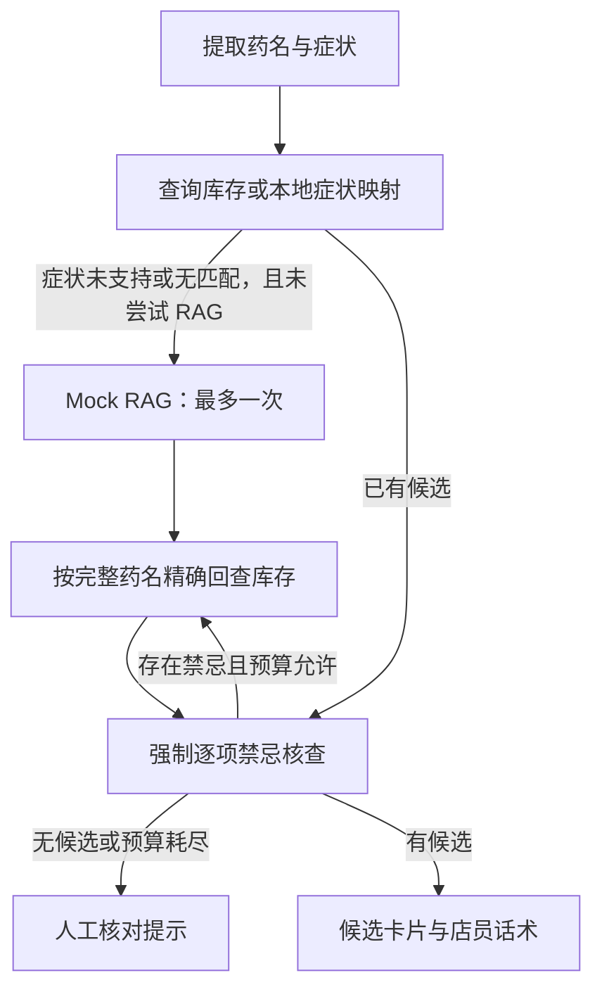

# 症状找药 Mock RAG 兜底

> 此文记录旧版模拟节点。当前已升级为[多轮语义理解与知识候选流程](pharmacy-semantic-workflow.md)，不再使用下述固定映射；当前上限是两次知识补查、三轮库存查询。

该节点验证执行图的分支与回查流程，当前没有向量检索、医学证据或真实 RAG 服务。

- `query_medical_rag`：感冒 → 感冒灵颗粒、板蓝根颗粒；发烧/发热 → 布洛芬；其他为空。
- `has_tried_rag` 防止重复调用；库存最多查询三轮（包含首次及 RAG 后回查）。
- 每轮可分别回查多个药名，工具计数按实际调用数记录；排除项始终过滤。
- 已指定药名的查询不自动替换；数据库异常、超时不伪装成知识缺失。
- 精确匹配不会把“感冒灵颗粒”替换为“复方感冒灵颗粒”，也不会把“布洛芬”替换为“布洛芬缓释胶囊”。需业务方维护明确的商品映射才可扩大匹配。
- 空结果、工具异常、无库存匹配均可终止；零库存仍标记缺货，处方提示保留。
- 命中库存后必须核查安全；Mock 药名不证明疗效或个体适用性，未命中禁忌也不证明安全。
- UI 的执行记录显示模拟映射节点，并展示 Mock 来源说明。

验证：`python -m unittest tests.test_pharmacy_graph tests.test_inventory_tools tests.test_pharmacy_ui tests.test_api_sse -v`
